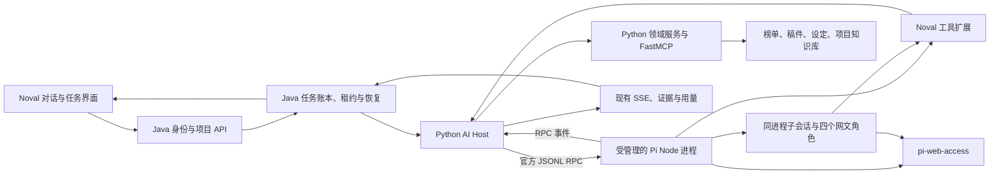

# Noval：由 Python 托管 Pi 的 Agent 替代实施方案（含原生会话契约）

> 文档 ID：`pi-agent-runtime-replacement-plan`
>
> 状态：`draft`
>
> 最后审核：`2026-10-09`
>
> 实施状态：**计划已整理，实施尚未开始；没有切换生产运行时。**
>
> 负责人：`agent-runtime`。本文是待实施方案，不覆盖当前源码、配置和历史验收事实。

## 1. 最终交付与替代边界

采用 **Python AI Host + Pi 官方 RPC + pi-subagents + pi-web-access + Noval 领域工具与技能**，承接现有网文助手。Pi 本身运行于 Node.js；Python 管理 AI 接口、进程、业务工具和请求资源，通用推理循环、原生会话、压缩及子代理使用 Pi 的成熟实现。Java 保留身份、项目权限和持久任务账本。

用户已明确 Pi 归 Python 侧管理。本版据此选定“现有 Python AI 服务就地改造”的实现，取代上一稿的独立 Node `pi-worker` 服务提案。代码目录和 Compose 服务名可暂留 `langgraph-worker`，以控制迁移范围；名字沿用不代表允许保留旧 Agent。

用户要求的是替代，以下约束贯穿开发、切换、回滚和后续维护：

1. **生产只有一种有效 Agent runtime：Pi。** 不保留自研 workflow/autonomous 的自动回退、影子推理、热备服务或隐藏开关。
2. **同一个任务只有一个有效执行者。** Java 管理任务的接收、租约、恢复和取消，Pi 执行已获租约的工作；重投递不能新开第二轮推理。
3. **原服务槽位就地替换，完整退役旧 Agent 实现。** 新 Python 镜像只加载 AI Host 与普通领域服务；旧 `NovelResearchAgent`、Harness、AgentKernel 和 LangGraph 执行链退出构建。独立小说分析保留 Python 领域逻辑，将模型步骤接到 Pi，不能继续初始化旧 Agent。
4. **复用领域能力不等于继续启动旧 Agent。** 榜单比较、检索、资料整理等抽成普通工具或函数，不把完整旧 Harness 包成 Pi 的一个工具。
5. **回滚也保持互斥。** 先停新执行、核对任务和副作用，再恢复经过迁移保护的旧版本；不让两套运行时同时接单。
6. **完成标准包含退役。** 新功能可用但旧服务、旧消费者或旧子进程仍在运行，替代就没有完成。

“一个 runtime”指一种生产执行实现，以及每个 run 的唯一租约持有者。首版使用一个 Python AI Host 进程，按已获准的活跃根任务启动有上限的 Pi 子进程；任务结束即回收，空闲时不保留每会话一个 Node 进程。增加 Uvicorn workers 或服务副本前必须完成跨进程所有权和预算控制，不能靠各自内存字典去重。

本次只编写方案，不安装候选包、不新增真实模型实验、不停止进程、不部署，也不删除现有实现。之前真实模型实验的额度已关闭，不能沿用为新集成的调用额度。

## 2. 已核实的现状

以下来自 2026-10-08 工作区源码审计，不代表已检查生产进程或证明旧 Agent 正在空闲时推理。

| 现有位置 | 源码事实 | 替代时必须处理的事项 |
| --- | --- | --- |
| `langgraph-worker/app/api/knowledge.py` | 模块级 `research_agent = NovelResearchAgent()`；提供 chat、stream、skills、provider tiers/probe、eval 接口 | 全部迁移或明确退役；删除旧入口和导入，不能仅修改前端地址 |
| `langgraph-worker/app/main.py` | 导入上述实例，退出时调用其 `aclose()`；同时挂载 analysis router | lifespan 改为管理 Python PiHost/普通客户端；删除旧 Agent 导入，模块加载时不启动 Pi |
| `app/services/novel_research_agent.py`、`harness/webnovel_harness.py` | 构造完整 Harness、自研 AgentKernel、规划/上下文/记忆组件，并编译 LangGraph | 不作为新工具层依赖；领域函数和旧执行装配必须分离 |
| `app/services/analysis_service.py` | 独立 `LangGraphAnalysisService`，包含分块、模型调用、合并、JSON 处理及自己的 LLM semaphore | 保留 Python 分块/校验等领域行为，模型步骤接 PiHost；移除 StateGraph 和独立许可池 |
| `scripts/pi-eval/session-bridge.mjs`、`services/evaluation/pi_kernel.py` | 评测使用 Pi 0.85.0；关闭通用扩展/模板/上下文发现；禁用 builtin tools；依赖 Python AgentKernel/宿主工具 | 只参考进程关闭、工具与会话测试；生产改用 1.1.0 官方 RPC，不保留旧 AgentKernel host 与评测私有 wire 协议 |
| `KnowledgeChatRunService`、`KnowledgeChatPersistenceService` | 已有 run、租约、fencing token、取消状态和终态写入 | 保留业务生命周期，扩展运行时归属与跨进程取消 |
| `KnowledgeChatRunRabbitConsumer`、`KnowledgeChatRunQueueService` | 消息包含 `runId` 与 EXECUTE/CANCEL；消费者可重投递 | 消息只作为唤醒信号，每次按数据库归属验证；不能凭老消息重新执行 |
| `KnowledgeChatRunRecoveryService`、Persistence `recoverExpiredRun()` | outbox 派发、超时回收；租约过期可直接新建 PENDING 重试，CANCELLING 分支可仅按宽限期和租约条件提交取消 | Pi 任务先核对旧写者、持久结果及停止证据，再决定补交/取消/重试；时间到期不证明旧执行已结束 |
| `KnowledgeChatService` | 流式失败且未出首段时，存在重新发起阻塞聊天的路径；还有专用 fallback executor | 替换为同 run 查询/重连，避免“断流一次、另开一次模型任务” |
| `KnowledgeChatRunSchedulingConfig` | heartbeat、delta、SSE、maintenance、application scheduled 和 fallback 线程池 | 按用途改造；不要把所有后台线程都误删或都保留下来 |
| `harness/tool_ledger.py` | 模块级 `governed-tool` ThreadPoolExecutor；工具请求内存在异步任务 | 旧实例和执行池退役；新工具执行由所属 run 管理并可取消 |
| `docker-compose.yml` | `backend` 指向 `langgraph-worker`；该服务配置自动重启；另有 `fastmcp-tools` | 在同一服务槽位替换镜像，加入锁定的 Node/Pi 依赖；核对旧镜像实例和外部自启，不能并排新增一套常驻服务 |

已有修复后的历史榜单比较可作为领域正确性基线。此前同模型小样本里，Pi、DSH、自写自主循环各完成两道核心比较中的一道，修复后的旧 workflow 完成两道。**这不证明新的 Pi 扩展组合已经更强，也不允许丢掉已正确的确定性比较能力。**

## 3. 目标架构与唯一责任人



| 责任 | 唯一权威 | 边界 |
| --- | --- | --- |
| 任务接收、恢复、重试、定时唤醒 | Java 现有任务/outbox 体系 | Pi 不独立扫描数据库或重复唤醒同一任务 |
| 推理、工具循环、压缩、子会话 | Pi 官方运行时与选定扩展 | Python 通过 RPC 控制；不在外面再包自研 planner/kernel 循环 |
| AI 接口、Pi 启停、RPC、在途请求释放 | Python PiHost | 按 Java 已授予的任务归属执行，不自建待办扫描或恢复调度器 |
| run 是否可以执行、预算是否可用 | Java 提供任务/配置权威；Python 统一执行校验与资源限制 | 模型、联网、子任务和分析共享归属；失去租约必须停止派发 |
| 项目事实、稿件版本、授权范围 | Noval 业务服务与数据库 | Pi session 和 Markdown 记忆不能变成第二份已确认事实库 |
| 工具实现 | Python 领域网关、FastMCP、业务 API 与纯函数 | Pi 扩展只做调用适配；不依赖 `NovelResearchAgent` 或其初始化副作用 |
| 会话对话与压缩记录 | Pi 原生 session 持久化；Python 管理文件生命周期；Java 保存映射和展示记录 | 使用官方会话接口，不假定旧 checkpoint 兼容，也不手写 Pi JSONL 内部格式 |
| 定稿、版本更新和记忆确认 | Noval 已授权的业务写入操作 | 子角色提出草稿或建议；写入走版本检查与幂等机制 |

拟新增 `langgraph-worker/app/services/pi_runtime/` 承载 Python 适配，`langgraph-worker/pi-runtime/` 承载锁定的 Node 依赖、薄扩展和角色。二者是同一个 AI 服务镜像的组成部分，不新增 Node HTTP 服务。确定性榜单比较可留在 Python 中；需要跨服务共享的能力才放到现有 FastMCP。

部署沿用现有容器体系，不额外引入每任务沙箱服务。Pi 扩展和角色显式装配；网文流程默认使用领域工具、联网与稿件操作。通用 shell/文件工具是否开放按实际产品任务决定，不能借此启动脱离任务管理的守护进程。

### 3.1 对应哪些现成实现

下列接口已从固定版本的发布包或当前仓库读取。版本约束和接口存在已核实，**整套集成尚未运行验收**。

| 需求 | 直接使用的现成实现 | Noval 要写的部分 |
| --- | --- | --- |
| Python 调用完整 Pi | Pi 1.1.0 [RPC 文档的 Python 示例](https://github.com/earendil-works/pi/blob/main/packages/coding-agent/docs/rpc.md)：`pi --mode rpc`，stdin/stdout JSONL | 异步管道、应答关联、超时、进程所有权和 FastAPI 接入；不写模型推理循环 |
| 会话与压缩 | 官方 `SessionManager`、精确 `--session`、`get_entries/get_tree`、`new_session/switch_session/fork/clone/compact` | 第 6.3 节的业务映射、写入所有权、分支游标、落盘校验与恢复；原生上下文投影和压缩交给 Pi |
| 流式、工具状态和结束 | [Pi JSON 事件](https://github.com/earendil-works/pi/blob/main/packages/coding-agent/docs/json.md)：`message_update`、`tool_execution_*`、`message_end`、`agent_settled` | 转成已有 `start/progress/delta/done/error`，补用量与证据归属 |
| 停止、补充要求、正常退出 | 官方 `clear_queue`、`abort`、`steer`、`follow_up`；关闭 stdin 触发清理 | 业务取消链、子任务精确取消、退出截止时间与所属进程树回收 |
| 子代理 | `pi-subagents@0.76.1` 的 `pi-subagents/delegation` | 一个窄的 `noval_delegate` 工具适配；复用现有 launcher、状态、结构化结果和用量 |
| 主子工具绑定 | 包的 `extensions` / `subagentOnlyExtensions`、`registerRequiredChildExtensions()`、`registerSubagentCapabilityCeiling()` | 提供 Noval 工具扩展、限定四角色和工具，正确注册/注销；不新写子 Agent 类 |
| 联网 | `pi-web-access@0.37.0` 的 `web_search`、`fetch_content`、`get_search_content`、`source_check` | 选择搜索后端、约束功能/预算、将来源接入 Noval 证据；不另建搜索 Agent |
| 模型编解码 | Pi 原生 provider 与 `pi.registerProvider()` | 注册指向 Python 请求网关的模型；网关处理凭据、额度和取消，不实现另一个 tool-call loop |
| 业务工具调用 | 现有 `McpClient.call_tool()`、`KnowledgeBackendClient` 和 `rank_comparison.py` | 拆掉旧 Harness 导入，保留签名和确定性业务逻辑，新增普通工具网关 |
| 持久任务、恢复、SSE | 现有 Java `KnowledgeChatRunService`、Persistence、Recovery、EventStream | 加执行归属/查询/取消契约，删除旧重执行 fallback；不新增第二套调度系统 |

Pi 的官方 RPC 适合跨语言宿主；官方 SDK 适合同进程 Node/Bun 宿主。本项目选前者。`pi-subagents` 的进程内事件总线不是 Python 可直接发送的 stdin RPC，必须由薄 TypeScript 扩展转接。

### 3.2 文件怎么落

以下新增名称是**拟实现文件**，当前尚未创建产品代码。前缀统一为现有 `langgraph-worker/`：

| 文件 | 处置与具体职责 |
| --- | --- |
| `app/main.py` | 改 lifespan：创建/关闭 PiHost、普通客户端；删除 `research_agent` 导入；导入阶段不 spawn Node |
| `app/api/knowledge.py` | 保留 chat/stream 等 HTTP 契约；通过依赖注入调用 PiHost；删除模块级 `NovelResearchAgent()` |
| `app/api/analysis.py` | 保留接口，调用已去掉 LangGraph 的 Python 分析服务 |
| `app/api/pi_bridge.py` | 拟新增内部工具、进度与模型转发路由；只接受 Host 绑定的执行凭据，不接受模型自行指定权限 |
| `app/services/pi_runtime/contracts.py` | 拟新增不可变执行上下文、RPC 记录解析和宿主结果类型；不复用旧 Kernel 的请求/结果类 |
| `app/services/pi_runtime/rpc_client.py` | 拟新增 JSONL 收发、单独 stdout/stderr 泵、命令 ID→future、异常退出与协议错误处理 |
| `app/services/pi_runtime/host.py` | 拟新增 run/attempt 幂等注册、进程/任务所有权、执行、取消、关闭；不做意图判断/规划/重试扫描 |
| `app/services/pi_runtime/sessions.py` | 拟新增会话预留/恢复、路径与日志校验、单写者所有权、持久结果/封存回执及按 ID 查询；Java 持久化映射，Python 不重写原生树/压缩算法 |
| `app/services/pi_runtime/domain_gateway.py` | 拟新增工具 schema→领域函数/客户端映射、授权上下文、来源和调用记录 |
| `app/services/pi_runtime/provider_gateway.py` | 拟新增受控 HTTP 流式转发、一次请求一次派发、共享 LLM 许可、取消与用量对账 |
| `app/services/pi_runtime/events.py` | 拟新增 Pi→worker 内部 SSE/响应映射，区分暂态、可提交结果、子任务与最终答案；浏览器终态由 Java 提交后发布 |
| `app/services/knowledge_client.py` | 保留业务方法；将 `ProviderDispatch` 等普通 DTO 移出 Harness，替换旧 `current_run_tool_ledger` 依赖 |
| `app/services/mcp/client.py` | 优先保留 `call_tool/list_tools/aclose`、逐次签名和 ContextVar 绑定，通过薄适配供网关调用 |
| `app/services/rank_comparison.py` | 保留 `requested_rank_periods()`、`build_rank_comparison()`，暴露为受控比较工具 |
| `app/services/analysis_service.py` | 保留分块/合并/JSON 校验，模型步骤改调 PiHost；删除 StateGraph、旧 checkpoint 和独立 LLM semaphore |
| `pi-runtime/package.json` 与 lockfile | 拟新增本服务专用依赖，不依赖机器全局 Pi 或旧 evaluator 的 node_modules |
| `pi-runtime/extensions/noval-provider.ts` | 拟新增 provider 注册，使用 Python 网关与短期执行凭据；前台子会话继承注册的 provider |
| `pi-runtime/extensions/noval-tools.ts` | 拟新增普通 ToolDefinition：调用 Python 工具网关，转发 AbortSignal、进度和结构化结果 |
| `pi-runtime/extensions/noval-delegate.ts` | 拟新增 `noval_delegate`：把角色任务转成现成结构化委派请求，转发进度/用量/取消 |
| `pi-runtime/extensions/noval-policy.ts` | 拟新增作用域绑定、主子工具选择和必要子扩展注册/注销；不含 planner 或调度器 |
| `pi-runtime/extensions/noval-session.ts` | 拟新增受控会话命令：转接 `ctx.navigateTree()`、通过 `pi.appendEntry()` 保存分支游标/操作标记，通过 `pi.sendMessage()` 注入有来源的迁移上下文；重建分支状态并清理会话资源 |
| `pi-runtime/agents/` | 拟新增四个领域角色定义；工具和扩展由受控配置明确提供 |

18 个旧领域 pack 作为内容来源，转换成 Pi 可加载的 skill 结构；构建或加载阶段生成资源，不长期人工维护两份不同正文。Node 模块只有扩展和依赖，不监听第二个 HTTP 端口。

### 3.3 Python 与 Java/Pi 分别传什么

**Java→Python：继续用已有 HTTP API，加后端生成的执行上下文。** 当前 Python `KnowledgeChatRequest` 有 `question/traceId/conversationId/projectId/workId/userId/contextSummary/history/limits`，没有租约身份。不能把 `traceId` 当执行所有权。

拟增加内部 `execution` 对象，例如以下合成示例；此对象由 Java 的任务服务填充，不开放给浏览器自行构造：

```json
{
  "question": "把这个榜单本周和上周的 Top10 比较一下",
  "conversationId": "conversation-demo",
  "execution": {
    "runId": "run-demo",
    "attemptId": "run-demo-attempt-1",
    "leaseOwner": "worker-demo",
    "fencingToken": 7,
    "runtimeGeneration": 2,
    "piSessionRef": "session-demo",
    "mappingVersion": 3,
    "branchRef": "branch-demo",
    "expectedLeafId": "entry-demo"
  }
}
```

Python 将执行身份与从业务服务确认的用户、项目、工具权限、预算绑定为不可变上下文。会话/分支目标由 Java 在创建/领取事务中绑定，并验证预期版本；不能等异步执行开始后才读取界面当前选中的分支。原 `/internal/knowledge/chat`、`/chat/stream` 继续工作；拟新增内部 run 查询/取消契约，可统一为 `/internal/knowledge/runs/{runId}`、其 `/cancel` 和带 `attemptId` 的 `/result` 查询。`/result` 查询持久回执，不能启动 Pi。这些字段和路由是 Noval 拟新增契约，不是 Pi 官方 API。

**Python→Pi：使用原生 JSONL。** 以下字段和命令已核对 1.1.0：

```jsonl
{"id":"cmd-1","type":"prompt","message":"把给定榜单的本周与上周 Top10 做比较"}
{"id":"cmd-2","type":"get_state"}
{"id":"cmd-3","type":"clear_queue"}
{"id":"cmd-4","type":"abort"}
```

实现 `rpc_client.py` 时采用 `asyncio.create_subprocess_exec()` 和独立异步读写任务，直接启动锁定 Node 与该包 `package.json` 声明的 CLI 入口；1.1.0 的入口为 `dist/bundle/cli.js`。不经 shell 拼接命令，也不依赖 Windows 的 `.cmd` 包装器处理参数。

- stdin/stdout 按字节 LF 分帧，接受 CRLF；不使用会把 U+2028/U+2029 当换行的通用文本拆行。限制帧大小与缓存，持续读取 stdout，避免背压阻塞工具或取消。
- 每条命令使用独立 ID；响应按 ID 匹配，事件另行分发。命令可以异步交错，不按返回顺序配对。
- `prompt` 的 `success:true` 只表示接受；`data.disposition` 可以是 `started/queued/handled`。`handled` 可能只是扩展命令处理，不应盲等一次新的模型结束事件。
- `agent_end` 不保证整个工作结束。正常结束至少等待 `agent_settled`，再核对最终消息是否成功、子任务与请求是否收敛；错误或 aborted 不能变成 answered。
- 新会话走预留/首次落盘流程，已有会话以授权后解析出的完整文件路径传给 `--session`；新建的 `--session-id` 与恢复的 `--session` 不能组合。不能用 `--session-id` 的“找不到则新建”冒充恢复成功。具体状态、校验和分支规则见第 6.3 节。
- 明确加载扩展/技能和工具清单。1.1.0 的 `--no-tools` 会禁用全部工具，不能照搬旧评测设置；使用显式工具选择，必要的 `read` 仅访问获准的技能/资料。
- RPC `prompt` 能执行扩展斜杠命令。普通用户文本需规范化为用户请求内容；内部控制命令使用独立白名单，不能让文本意外变成 `/subagent` 等控制操作。

### 3.4 事件如何接回已有界面

Java `LangGraphWorkerClient.processKnowledgeEvent()` 已识别 `start`、`progress`、`delta`、`done`、`error` 和两种 context 事件。下表描述 **Python→Java 的 worker 内部协议**；其中 `done` 表示 worker 已提供可提交的封存结果，与 Java 提交后发给浏览器的终态不同：

| Pi 信号 | Python 输出/处理 |
| --- | --- |
| `agent_start` | `start` 或任务已开始的进度；不能重复创建 Java run |
| 根会话 `message_update` 中 `text_delta` | 可展示的 `delta`；按消息边界维护暂态文本，不混入 thinking 或子角色文本 |
| `tool_execution_start/update/end` | `progress`，填 `phase/message` 和现有工具进度字段 |
| compaction 开始/结束 | 映射 `context_compacting/context_compacted`；缺少的 token 指标留空，不伪造 |
| `message_end` | 以完整 message 覆盖暂态重建；1.1.0 源码先发事件再写原生日志，所以此事件不代表已落盘；用量不能每个 delta 重复累加 |
| 委派 started/update/response | 薄扩展回传 Python 的内部进度入口，按根 run 和精确委派身份记录；不直接冒充父会话最后回答 |
| `agent_settled` + 本轮有效结果 + 所有受管工作收敛 + 会话与结果回执已持久化 | Python 发内部 `done`，`data` 使用现有 `KnowledgeChatResponse` 并携带回执引用；此时 Java 业务终态尚未提交 |
| 命令拒绝、provider 失败、异常退出 | 真实 `error` 或对应失败状态；不自动改发一遍旧 `/chat` |

现有响应的 `status/answer/candidates/sources/actions/resultJson` 保留。内部 `done.answer` 取本轮最终答案，不能把工具前后的文本简单串起来。Pi 的 runtime/session/子任务/用量元数据作为明确的新字段加入 `resultJson`。拟新增 `resultJson.runtimeCompletion` 包含 `runId/attemptId/executionOutcome/nativeSessionRef/mappingVersion/receiptRef/resultHash`；这些是宿主结果字段，不是 Pi 原生事件。

完成顺序必须为：**Python 封存日志与完整业务结果 → 内部 `done`/HTTP 结果返回 Java → Java 校验回执、归属、会话版本和取消状态并事务提交 → Java 发布浏览器终态。** 现有 Java 在读取 worker 的 `done` 后才调用 `completeAnsweredRun()`；不能让 Python 等这个事务完成才返回内部 `done`，否则形成循环等待。事务中同步提交回答、会话游标、回执关联和持久终态事件，发布失败只重放事件。

Pi 路径必须删除 `LangGraphWorkerClient` 中“最终 answer 为空就用累计 delta 补齐”的成功兜底，并拒绝缺少有效完成回执的 EOF/结果。取消、失败或尚未完成的文本不能被升级为成功回答；候选选择等合法业务状态按各自响应 schema 验证，不强制所有完成结果都包含普通答案文本。兼容 stream 也须先经过同一 Java 提交，再向浏览器发 `done`。

### 3.5 模型和领域工具怎样接入

**模型请求选择 Python 网关，Pi 保留原生 provider 实现。** 拟在同一 FastAPI 服务内提供仅内部可达的 provider 转发路径，支持本项目实际使用的 Chat Completions/Responses 方言。Node 扩展通过 `pi.registerProvider()` 指向这个网关，持有短期执行凭据；真实上游凭据留在 Python/现有配置服务。

网关只做配置解析、授权、统一许可、HTTP 流式转发、取消与对账，不推理、不拆 tool call、不做意图路由；不把 `AgentKernel._resolve_*` 继续当公共模型服务使用。Pi 原生 provider 仍负责工具消息、推理参数和事件编解码。Python 对单次请求只派发一次，生成内重试交给 Pi 的受控策略；避免 Pi 重试、Python 重试和 Java fallback 三层相乘。

首版单个 Python Host 的共享 LLM 许可覆盖所有根/子进程、压缩和分析步骤；增加副本前改成跨实例统一许可。子会话继承父扩展注册的 provider，但必须验证所有实际模型请求都经过网关。扩展私自选择外部模型或搜索摘要模型不能绕过预算，未接入预算的分支不启用。

**领域工具保留 Python 实现。** Node 的 `noval-tools.ts` 根据受控 schema 注册工具，将 `toolCallId + name + arguments` 送到拟新增的内部工具入口。执行身份和权限来自 Host 绑定，不接受模型传来的 userId/projectId 覆盖。结果返回标准 `content` 及匹配 schema 的结构化数据。

| Pi 可用工具 | 对应现有 Python 资产 |
| --- | --- |
| `skill_lookup` | `SkillRegistry` 与 `app/services/skills/packs/` |
| `rank_lookup`、`rank_research_pack` | `KnowledgeBackendClient.lookup_rank()`、`get_rank_research_pack()`，或已登记的对应 MCP 工具，选择一条调用路径 |
| `book_research_pack` | `get_book_research_pack()` |
| `knowledge_vector_search` | `search_evidence()` |
| `project_resolve`、`project_retrieve` | `resolve_project_work()`、`retrieve_project_knowledge()` |
| `project_foreshadowing_list/aggregate` | `list_project_foreshadowings()`、`aggregate_project_foreshadowings()` |
| `project_timeline_lookup`、`project_character_state_lookup`、`project_world_rule_lookup` | 对应三个已有 `lookup_project_*()` 方法 |
| `rank_compare`，拟新增 | `requested_rank_periods()` / `build_rank_comparison()` 与有界历史查询组合，不另写一套排名算术 |

现有 12 个名字来自 `autonomous_tools.py` 的点号→下划线规则。保留工具描述和参数约束，提取其定义，不继续引用依赖旧 owner 的执行对象。`KnowledgeBackendClient` 当前导入旧 `provider_dispatch_scope` 和 `tool_ledger`，必须先拆为普通 DTO/事件记录接口；直接 import 旧账本会把旧执行池依赖带回来。

`McpClient.call_tool()` 已实现时间戳/nonce/HMAC、内部 token、隐藏参数与每请求 ContextVar。当前 FastMCP `/mcp/v1` 校验 `x-noval-mcp-envelope`。因此主子会话都通过 Python 网关复用签名能力；单纯配置 Pi 的 MCP URL 和静态 header 不足以接通本项目工具。

### 3.6 子代理和联网的具体接法

`noval_delegate` 是拟新增的薄工具，输入只提供已配置角色、任务和结果模式。它使用真实的 `pi-subagents/delegation` 导出：

```text
SUBAGENT_DELEGATION_REQUEST_EVENT   = prompt-template:subagent:request
SUBAGENT_DELEGATION_STARTED_EVENT   = prompt-template:subagent:started
SUBAGENT_DELEGATION_UPDATE_EVENT    = prompt-template:subagent:update
SUBAGENT_DELEGATION_RESPONSE_EVENT  = prompt-template:subagent:response
SUBAGENT_DELEGATION_CANCEL_EVENT    = prompt-template:subagent:cancel
```

1. 先订阅再发送请求；用 `ownerRunId + nodeId` 标识逻辑子任务，用 `requestId` 标识尝试。将根 Java run 与该身份关联保存。
2. 请求使用现成的 `agent/task/context/cwd/timeoutMs/toolBudget/result` 字段；结构化结果用包的 schema 验证机制。
3. 只使用前台结构化委派。`subagents:rpc:v1:request` 的 `spawn` 是 async-only，会走后台执行，本方案不用它来发起网文子任务。
4. 收到父工具的 AbortSignal 时，对同一身份元组发送 CANCEL；取消早于 started 的竞态由包的现成机制处理。收到 terminal 后释放订阅和 Host 记录。
5. update 是累计快照，替换旧快照；terminal 的 status/result/usage 才是最终依据。缺少用量是未知，不是 0；父子统计不得重复加总。
6. 在 `session_start` 使用原生 session ID 注册必要子扩展和 capability ceiling，在 `session_shutdown` 注销。`registerRequiredChildExtensions()` 的输入为 `{ sessionId, extensions: [{ id, path }], requireForAllRunners: true }`，路径从已安装资源解析。
7. 子角色明确加载 `noval-tools`、必要的 `noval-policy`；需要联网的角色再明确加载 `pi-web-access`。不要把整个父扩展集合重新加载进前台子会话，尤其不能再启动一份父委派控制器。
8. 根模型只拿到 `noval_delegate`，不开放原始的异步 spawn/schedule 管理；子角色默认不再委派。角色定义和能力上限共同约束工具，缺工具在启动前失败。

**前台委派不等于扩展没有恢复或定时逻辑。** 0.76.1 的 `src/extension/index.js::resetSessionState()` 仍会恢复活动工作、绑定 scheduled-run manager、恢复等待订阅并启动结果 watcher。因此配置必须明确 `asyncByDefault:false`、`scheduledRuns.enabled:false`，独立核对 watchdog/mission/通知与工具自动激活设置，不能用隐藏参数或 `disabledFeatures` 代替执行开关。托管的扩展配置与状态目录不得复用用户机器上的安装目录、旧异步结果或旧计划任务；只按 Java 当前执行意图装配所需状态，原生会话日志独立保存。

M1 必须验证冷启动、恢复、fork/new 和 shutdown：未提交工作时不会因旧插件状态新增模型请求或任务；允许的进程内结果监听随所属 run 退出。若所选版本不能满足这些约束，将该扩展标为接入阻塞项，在隔离环境修正适配/选定兼容版本，不以“调用的是前台接口”宣告通过，也不复活旧 Agent 兜底。

`pi-web-access` 默认自动路由可尝试多种搜索后端，部分模式还能生成摘要。这里明确选择已有配置的后端；普通查找使用无额外摘要 workflow，按需启用 `web_search/fetch_content/get_search_content/source_check`。未配置时显示未配置，不自动寻找其他账号。浏览器、curator、额外模型摘要和独立 MCP server 不是首批默认启动项。搜索失败的受控重试也进入总次数/费用预算。

前台子会话可以加载明确列出的工具扩展；需要 ambient MCP adapter 的路径有不同限制。采用显式 Noval 工具扩展调用 Python 网关，避免为了取工具被迫切到 detached runner。

### 3.7 一次历史榜单比较如何走通

```text
用户：“拿往期历史榜单和这周比较一下”
  → Java 创建/领取 run，绑定用户、项目和执行代次
  → Python PiHost 获取该会话锁，启动/打开对应 Pi 原生 session
  → Pi 根据已有会话范围选择 rank_compare 或有界历史查询
  → noval-tools 把参数发给 Python domain_gateway
  → 现有客户端查询完整快照，build_rank_comparison 按作品 ID 计算
  → 结构化差异、实际日期、覆盖范围和来源进入 Pi
  → Pi 解释结果；Python 映射进度和最终回答给 Java
  → agent_settled + 子任务/请求收敛 → 关闭 Pi、校验持久会话 → 提交一次结果与会话引用
```

简单比较不启动四个子角色。审稿或独立资料核查确有价值时，才由同一 run 委派。后续追问从相同原生 session 和业务范围继续，旧消息里的日期判断仍需用实际归档证据验证。

### 3.8 进程、取消和会话落库

Python 每个活跃根任务保存 `(runId, attemptId, generation, lease, sessionRef, process, rpcClient, activeChildren, requests)`。重复 HTTP 请求返回同一个执行句柄；同一 session 的不同 run 也须互斥，不能只锁 runId。

Java 保留持久状态和任务恢复权威。原生会话映射按第 6.3 节存业务身份、Pi 文件/分支、版本、提交位置与单写者归属；不得直接返回容器绝对路径给前端。`runId`、Pi session ID、entry ID 和 SSE 游标各有职责，不能互换。新建空会话尚未落盘是合法状态，已提交的会话文件丢失则必须报恢复异常。

结束/取消顺序固定为：

1. Python 在正常完成时进入 closing，取消时进入 stopping，拒绝该 attempt 的新工具和模型请求。
2. 取消中的 run 先发送 `clear_queue`，再发送 `abort`；官方文档明确 `abort` 本身不会清掉待执行的 steering/follow-up，漏掉第一步可能继续执行。正常且已完全收敛的 run 直接进行关闭，不补发一次取消。
3. 取消时对已登记的结构化子任务发精确 CANCEL；等待 terminal/请求关闭，保留未知上游结果，不以本地取消冒充已结算。正常完成则要求这些子任务已结束，不能仅凭父会话 settled 就遗弃子工作。
4. 在 settled 后取得本轮条目/最终答案及用量，关闭 stdin 请求 Pi 清理运行时；取消路径先完成上述 abort。stdout/stderr 继续排空到 EOF，等待进程退出。关闭钩子也可能写日志，退出前的内存快照不是最终持久化回执。
5. 超过关闭期限，终止该 run 拥有的进程组；Windows 开发环境使用受管进程树机制，Linux 容器使用受管进程组和容器退出兜底，不按进程名字全局杀进程。
6. 在仍持有写入所有权时检查最终文件与本轮提交边界，完成存储同步，将完整结果与封存回执持久保存后返回 worker 内部结果。Java 再按 fencing 与映射版本提交结果、会话引用和终态；缺少回执或提交不确定时进入待恢复。进程/请求已收敛的许可及时释放，但 session 的业务移交须等 Java 提交或恢复对账，不通过持有模型许可等待数据库提交。Python 崩溃后的恢复仍由 Java 决定，Host 不扫描目录自动重跑。

取消或强制退出按第 6.2 节另行核对停止证据；不能要求先生成一个成功答案才能确认停止。执行已停止而原生文件无法封存时，可以结束取消状态并释放已回收的执行资源，但会话保持 `RECOVERY_REQUIRED`，不能标为 `READY` 或允许下一轮直接打开。

**关闭期限必须覆盖整条链。** 当前 Compose 未显式设置 `stop_grace_period`，Dockerfile 直接启动 Uvicorn；M1/M5 必须把 Host 停止接单、drain、取消子工作、封存和进程回收接到实际服务信号路径，并验证子进程回收机制。不能只在请求已经结束后才会执行的生命周期清理中等待这些步骤自行发生。

冻结 `T_drain`、`T_cancel`、`T_seal` 与安全余量；若 drain 在容器收到停止信号后执行，容器/服务管理器强制终止期限必须覆盖它们之和。若发布脚本先完成外部 drain，则只计入剩余阶段。Uvicorn 等待请求的期限、Host 关闭截止时间、Compose 停止宽限期和外部发布超时需一起核对，内层不能在外层强制终止之后才计划封存。数值由 M5 实测确定，不直接沿用未核实的默认值；强制终止后的日志与结果按第 6.3.6 节恢复。

首版每轮按需启动、结束回收；后续是否使用有界热池由启动耗时实测决定，不默认让每段历史会话占一个后台 Node 进程。

### 3.9 可以直接拆给实现的首批改动与测试

| 改动包 | 最小可检查结果 | 对应测试 |
| --- | --- | --- |
| A：RPC/进程适配 | Python 能通过官方 RPC 发送模拟 prompt、接事件、关闭进程 | 拟新增 `test_pi_rpc_client.py`：ID 乱序、分片 UTF-8/Unicode 分隔符、背压、接受不等于完成、EOF/异常退出 |
| B：Host 与执行归属 | 两个相同 run 请求只启动一个进程；不同 run 不并发写同一 session | 拟新增 `test_pi_host_lifecycle.py`：重复提交、锁竞争、租约丢失、取消早于启动、停止回执、真实 SIGTERM/强制退出及进程/许可归零 |
| C：工具与比较纵向链路 | 真正的 Pi RPC 调到 Python 工具网关，再到现有确定性榜单逻辑 | 拟新增 `test_pi_domain_gateway.py`；复用历史榜单 fixtures 和现有正确性断言，覆盖签名、项目范围和工具错误 |
| D：provider 网关 | Pi 使用自身协议访问模拟上游，Python 控制总并发与取消 | 拟新增 `test_pi_provider_gateway.py`：主/子/压缩共享额度、HTTP 断开、流式透传、超时、无隐形重复派发 |
| E：角色和扩展 | 实际扩展通过结构化委派执行前台子会话，工具确实可调用 | Node 侧拟新增扩展集成测试：重复身份、取消竞态、缺工具失败、前台结果/用量、禁止 detached/schedule |
| F：旧入口退役与完整接线 | Python chat/analysis 使用 PiHost，新镜像不含旧 Agent | 拟新增 `test_pi_agent_retirement.py`，更新 `test_knowledge_api.py`、Java client/run/application 测试及前端现有用例 |
| G：原生会话存储与恢复 | 相同 Pi session 在进程退出后保留用户消息、工具结果和原生上下文；文件异常不静默重置 | 拟新增 `test_pi_session_store.py`、`test_pi_session_recovery.py`：空会话、缺档/截断、磁盘失败、精确恢复、封存与 DB 提交间崩溃、旧写者未退出 |
| H：会话控制与分支 | 使用真实 RPC/扩展完成新建、切换、fork、clone、树导航与压缩 | 拟新增 `test_pi_session_controls.py` 及 Node 扩展测试：取消切换、游标持久化、当前分支过滤、压缩/上下文编辑重放、扩展上下文失效 |

上述测试名均为拟新增或已标明的已有文件，不声称现在已有可运行实现。G/H 的原生机制属于 M1 前置门槛，不能推迟到最终接线时才验证；Java 事务与前端部分在 M4 完成。先用真实 Pi 运行时配模拟 provider 验证机制，再按单独预算验证完整网文质量。测试成功也不省略 M6/M7 的停旧和重启验收。

### 3.10 确定性的运行时装配

Pi 1.1.0 官方 `docs/cli.md` 明确：普通 `--tools` 白名单不移除仍可间接调用的 MCP 工具；`--no-extensions` 关闭发现/配置/内置扩展，但显式 `-e` 仍加载。生产启动必须使用以下已核实参数组合，并在 M1 生成实际 argv 清单：

```text
--mode rpc
--no-extensions --no-mcp
--no-skills --no-prompt-templates --no-context-files --no-themes
--no-builtin-tools
--extension <锁定的 Noval 与获准第三方扩展，逐项列出>
--skill <构建出的网文技能目录>
--tools <当前角色获准的完整工具名列表>
```

这是待实现的参数模板，不是可直接运行的命令；占位路径在构建时解析。全新/已有会话再分别附加第 6.3 节的创建或精确恢复参数。主会话通过 Python 网关访问 FastMCP，首版不另开 Pi 原生 MCP 连接。默认不开放原生 `bash/edit/write`；需要文件读取时必须提供能约束授权资料路径的适配，不能把一个未经限制的 builtin read 误称为已隔离。

`PI_CODING_AGENT_DIR`、cwd 和配置均由服务管理，不继承操作员的全局 Pi 目录、项目上传文件中的 `.pi` 配置或环境中的其它 provider 凭据。只注入网关访问所需的短期执行信息。插件拥有独立配置/目录发现机制，需要一并限定；关闭 Pi 核心发现不代表插件自己的发现也被关闭。

每次启动/恢复/reload 后、首次模型调用前核对实际加载扩展、模型路由和可调用工具集合。子会话的 SDK `DefaultResourceLoader` 不自动继承父 CLI 参数，须按子启动契约显式关闭 ambient 资源并限定扩展、技能、context 和 MCP；不能仅比较模型声明出来的工具名称。`--no-mcp` 也不能关闭另一个替代 MCP 扩展，因此未列入清单的适配不得加载。验收用多余扩展/隐藏 MCP/旧插件状态作为负向样本，证明均不会获得执行入口。

## 4. 组件处置清单

| 组件 | 最终处置 | 交付要求 |
| --- | --- | --- |
| `NovelResearchAgent`、WebnovelHarness、AgentKernel、自研自主循环 | **替代并退出生产构建** | 只在只读历史证据或版本记录中保留；生产没有可激活入口 |
| 旧 intent→plan→expert→review→revise 控制流程 | **由 Pi 承接** | 提取有价值的领域规则；不继续作为嵌套 Agent 调用 |
| 旧 LangGraph checkpoints 与状态转换 | **退出活动路径** | 历史留存；迁移必要业务事实，不跨格式直接恢复 |
| 独立小说分析 | **功能迁移** | 直接分析、分块分析、合并、结构化输出、流式和取消均覆盖后退役旧实现 |
| 18 个领域 skill pack | **保留并适配** | 迁到新服务可加载的资源；保留规则、来源、版本，去掉旧 Harness 专用字段 |
| 12 个只读领域工具 | **保留并解耦** | 显式注册到主会话及需要的子会话；核对参数和结构化输出，禁止导入旧 owner |
| `rank_comparison.py` 确定性算法 | **保留为工具能力** | 负责日期/完整性/作品身份/名次计算，Pi 负责提出查询和解释结果 |
| 榜单/作品/项目稿件/伏笔/时间线/人物状态/世界规则数据 | **保留** | 不重建数据，不自动清库或丢弃索引 |
| Java 身份、权限、conversation、run、outbox、事件/SSE | **保留并改造** | 全部新请求经过同一任务归属和幂等入口 |
| provider 配置、用量、限流、trace | **保留业务契约，改为 Python 请求网关** | Pi 使用原生 provider 编解码，Python 负责上游凭据、统一额度、转发与取消；不继续调用旧 AgentKernel 的模型方法 |
| 旧 stream→blocking 重执行 fallback | **删除** | 用原 run 的事件重放、查询和受控恢复替代；明确删除多余 executor |
| 旧 Pi/DSH evaluator 与 Node 桥 | **离线归档/研究用途** | 不进生产镜像，不随启动、定时评测或故障恢复运行 |
| 旧自动评测路径 | **迁到 Pi 或退役** | 保留评测数据；上线时旧评测队列不能重新启动旧 worker |
| 爬虫、索引、导入、文档批处理 | **保留业务后台任务** | 分别列资源归属、并发和关闭方式；涉及模型调用的步骤纳入预算并迁出旧 worker |
| `langgraph-worker` Compose 服务槽位 | **就地替换镜像** | 保留 Python HTTP 边界；旧镜像/PID、旧代码入口和会拉起旧版本的自启配置退役，必要业务服务的正常 restart 保留 |
| `langgraph` 及仅为旧 Agent 服务的依赖 | **删除生产依赖** | 先迁走分析和纯工具，再检查完整导入图；业务确有需要的 HTTP/MCP 库保留 |
| 旧治理界面中的 kernel/workflow 参数与默认分支 | **删除或迁移** | 界面不能保存一个后台仍然生效的旧模式开关 |

历史代码若尚未提交，先保存可校验的只读归档；不能以“Git 历史里应该有”为理由删掉唯一实验副本。归档不挂进生产容器，也不自动安装依赖。

## 5. Pi 包组合、角色与产品能力

### 5.1 首批依赖

| 包 | 2026-10-08 核查到的候选版本 | 使用方式与门槛 |
| --- | --- | --- |
| `@earendil-works/pi-coding-agent` | `1.1.0` | Python 通过官方 RPC 运行完整 Pi，保留原生 session/资源/扩展能力；包要求 Node.js ≥ 22.19.0 |
| `pi-subagents` | `0.76.1` | 首版只用同进程前台子会话，受父 run 管理；禁止 detached runner |
| `pi-web-access` | `0.37.0` | 显式指定搜索后端及使用范围；网络请求、费用和可能的子进程纳入 run 生命周期 |
| `pi-goal-x` | `0.32.3` | 首次替代不安装；持续任务先使用 Java 已有生命周期。后续只有能禁用独立唤醒、接入同一任务账本才考虑 |
| Pi SDK tools / Python 工具网关 | 随锁定版本 | 薄扩展通过 Python 签名网关访问现有 FastMCP；首版关闭 Pi 原生 MCP，按第 3.10 节限制实际可调用能力 |

版本是候选组合，不是已验证的兼容矩阵。已读取上述三个锁定版本的发布包并验证 npm integrity；Pi 与 pi-web-access 均声明 Node.js ≥ 22.19.0。`pi-subagents@0.76.1` 的 `pi-ai >=0.86.1` peer 要求与现有评测的 `0.85.0` 不兼容。实施仍需验证包间运行兼容、许可证和无终端集成，然后固定 lockfile；不直接在生产运行 `latest` 安装。

普通 Pi 的 `pi install npm:<package>` 不会使 Noval 现有 evaluator 自动加载扩展。新服务需显式加载资源、注册工具并做“主会话可调用、子会话也可调用”的测试。`pi-subagents` 前台子会话不自动继承父会话的 ambient extensions，只声明工具名不足以得到实现。

DSH、OpenCode 和 Codex 不作为 Pi 故障时的自动替补；如选型验收失败，应在切换前重新决策，而不是把多个运行时永久带进生产。

### 5.2 四个网文角色

这些是拟建的 Noval 角色定义，不是声称存在同名 npm 包，也不常驻四个进程。

| 角色 | 职责 | 默认可用能力 |
| --- | --- | --- |
| 市场研究员 | 历史榜单、题材趋势、作品样本、来源核查 | 查榜、确定性比较、作品研究、联网及证据读取 |
| 故事策划 | 大纲、人物弧光、世界规则、章节目标 | 项目知识与设定读取、领域 skills、方案草稿 |
| 章节作者 | 按已确认设定写作和修改 | 稿件/设定读取、章节草稿输出、受控草稿保存 |
| 连续性编辑 | 时间线、伏笔、人物状态、设定冲突和原文核查 | 原文定位、项目事实工具、独立审稿；不直接覆盖定稿 |

简单查榜由主会话直接完成。只有任务需要独立资料或复核时才委派；不固定“每问一次必跑四个角色”。默认禁止递归无限委派，同一根任务共享总预算和取消信号。

### 5.3 功能对等与补齐清单

| 产品能力 | 本次替代的实现要求 | 验收证据 |
| --- | --- | --- |
| 最新/历史榜单比较 | 完整周期快照、榜单身份和日期语义进入结构化工具契约 | 正确日期、作品 ID、涨跌、新进/退出、完整来源 |
| 多轮追问 | 恢复 Pi session 与榜单/项目范围；必要时重新取历史证据 | “那和上周比呢”实际查询上周，不只重述上轮 |
| 项目知识问答 | 保留项目权限、证据 ID、检索覆盖、文档版本 | 引用可回到对应原文与版本，不串项目 |
| 选题、大纲、写章、审稿 | 迁移 skills，显式提供角色工具；用户要求与助手建议分开 | 完整任务人工评审，不能只以 answered 判成功 |
| 草稿保存与修订 | 先完成接口盘点，再补版本化草稿写入与幂等提交 | 同一操作重试只新增一次；冲突不覆盖用户新稿 |
| 小说独立分析 | 迁移分块、聚合、JSON 校验/修复、流式进度和取消 | 与原分析输入输出契约一致；所有调用进入总预算 |
| 原生会话与压缩 | 使用 Pi 原生能力；存储隔离、版本、恢复和压缩后证据重载 | 重启/压缩后事实来源、任务进度和边界仍正确 |
| 长任务后台继续 | Java 保留 durable run，Pi 在该 run 租约下执行 | 页面关闭不复制任务；任务状态、取消和续作明确 |
| 主动停止与反馈 | 将用户停止/补充要求映射到已验证的 Pi API 和任务状态 | 停止覆盖父子任务；补充要求不误开独立重复 run |
| 治理、模型配置、trace | 保留业务入口，迁移 provider probe、skills、tiers 和费用映射 | 每条调用可归属到 run/角色，界面无旧模式开关 |

现有控制器可确认创建作品、导入任务、文档批次和章节 tombstone 等操作；尚未发现可直接认定为“作者草稿保存＋版本修订”的完整公开契约。因此草稿写入是明确的实现任务，不能把导入或 tombstone 接口冒充为保存接口。

## 6. 任务归属、恢复、会话与资源契约

### 6.1 每个任务只执行一次有效尝试

保留 `ai_chat_run`、`ai_chat_run_outbox`、租约和 fencing token。拟增加运行时类型/版本、部署代次、原生 session 映射、父子任务归属等字段或关联表，具体迁移命名在实现时定稿；这些并非当前已经存在的字段。

执行协议必须满足：

1. 创建任务、绑定 runtime 归属和写 EXECUTE outbox 在同一事务中完成；同步、流式、队列及本地执行入口均经过这一步。
2. 消费者收到 `runId` 后重新查询状态、部署代次、取消标志和租约；旧代次/终态消息确认处理并留痕，不无限 nack/requeue。
3. Python PiHost 对同一 run/attempt 的重复提交返回现有执行或状态，不再次发送 prompt。Pi 原生 RPC 的 `id` 只用于应答关联，不是业务幂等键。会话写入也要有锁，防止不同 run 同时打开同一原生日志。
4. DB fencing 保护写入；Python 模型/工具网关在请求派发前校验租约与代次。只阻止结果落库仍可能继续浪费模型费用，不能算完成。
5. 失去租约、取消、服务关闭、预算耗尽，均停止后续模型/工具派发并中止在途请求。Java 心跳存活不能代替 Pi 工作是否存活的判断。
6. 重试明确区分连接重连、执行恢复和新尝试。断开 SSE 优先重放已持久化事件；不触发第二个 chat 请求。
7. 稿件写入、记忆确认等副作用携带稳定操作 ID、预期版本和请求摘要，由业务服务原子去重。消息和模型调用可能重投递，不能声称全链路天然 exactly-once。
8. Pi run 租约过期后先进入待对账逻辑，核查旧进程、持久结果回执和副作用；不得直接走当前 `recoverExpiredRun()` 的“FAILED＋新 PENDING run＋EXECUTE”分支。恢复所有者用新租约校验原 attempt 的回执并补交，不复用失效 token 直接提交，也不因此启动新一轮 Pi。
9. 只有证明旧写者已退出、原尝试结果已明确且重试政策允许后，Java 才能创建唯一后继尝试。取消标志和当前代次优先；若结果已经封存则补交原结果，未知状态保持待恢复。同一个恢复操作要原子去重。

现有 `ai_chat_run.parent_run_id` 用于重试谱系；Pi 子代理的 `ownerRunId/nodeId/requestId` 是同一尝试内的委派谱系。两类关系分别保存，不能把 SDK 子会话直接塞成另一个可独立消费的聊天重试任务。

旧二进制不会因为数据库多了字段就自动遵守这些规则。切换前必须部署入口保护，或证明所有不受保护的旧实例已停止；不能只依赖新服务的 fencing 来阻止旧程序继续调用模型。

### 6.2 取消与持续任务只有一条控制链

`用户停止 / 超时 / 预算上限 / 租约丢失 → Java run → Python PiHost → Pi 主会话及已登记子会话 → 模型、联网与工具请求终止 → 终态及进程释放`。

- 取消通道不能排在已满的 EXECUTE 队列后面等待；使用独立控制调用和持久取消标志，队列 CANCEL 只是补充通知。执行租约失效后，当前获授权的 Java 控制方仍可停止指定旧 attempt；不能要求旧生成凭据继续有效才允许取消。
- Python 活跃 run 注册表保存 RPC 客户端、PID/进程组、子会话身份、请求与关闭句柄；Node 薄扩展转接 AbortSignal 和精确子任务取消。所有路径执行 finally 清理。
- 首版关闭 `pi-subagents` detached/background runner 与独立目标轮询。需要页面后台继续时，由同一个 Java run 承载，不另开守护进程。
- 服务收到 SIGTERM 后停止接单，进行有界 drain；到时取消剩余工作并等待子资源退出。进程重启只由 Java 恢复有效 run，Pi 不自行重放所有 session 文件。
- 取消本地 HTTP 不保证上游立即停止计费。保存请求 ID、用量和未知结果，按上游可用的状态/超时证据结清；不能把未确认调用记成零消耗或直接重开同一任务。

**取消确认与执行停止分开。** 当前 `KnowledgeChatRunRecoveryService` 使用 3 秒取消宽限期，Persistence 在取消状态和失效/缺失租约满足条件后可直接写 `CANCELLED`；`KnowledgeChatRunService` 也会在 Java 流式调用返回或异常后直接完成取消。这些路径没有 Pi 停止证据，不能原样复用。

| 情况 | Pi 路径的处理 |
| --- | --- |
| 尚未派发且已原子禁止领取 | Java 证明该 attempt 从未获得执行授权后可直接取消；不为取消空任务启动 Pi |
| 只收到取消请求回执或流连接关闭 | 保持 `CANCELLING` 并继续独立停止/查询；回执接受不等于主/子工作已退出 |
| Host 确认本地受管执行停止 | 校验并持久保存停止证据，再提交 `CANCELLED`；证据绑定 run/attempt/代次，包含执行授权撤销、所属进程树、模型/工具请求的关闭结果 |
| 租约失效、控制调用超时或 Host 重启后查无活动句柄 | 继续待核对；`NOT_FOUND`、心跳超时或 PID 不在内存注册表都不是停止证明。须取得持久停止回执或经部署方确认原进程树/容器退出，并核对剩余请求 |
| 本地执行已停止，远端结算未知或会话损坏 | 取消终态与远端费用对账、会话恢复状态分开保存；不把未知费用记零，不放开受损会话的后续写入 |

取消意图与成功提交在同一任务锁/事务条件下决胜：取消先提交则不能再发布成功答案，已成功提交的终态不会被迟到的取消改写。已经完成的稿件等副作用保留事实并去重，取消不冒充业务回滚。同 conversation 的准入除检查活动 run，还要检查原生映射是否仍待清理/恢复，防止任务已结束却再次打开未就绪文件。

**静默流也必须可停止。** 现有 Java 两个流式 reader 都在 `readLine()` 返回后才检查取消。Pi 接线须为知识聊天和独立分析提供不依赖下一条 SSE 数据的取消/超时处理，可主动关闭所属传输，并通过独立控制通道停止或查询原 run。分别约束连接等待、流空闲、任务总期限和清理期限；仅设置 `HttpRequest.timeout()` 不作为流体中断能力已验证的证据。真实存活状态可用于心跳，不能伪造任务进度或无限延长总期限；传输超时按原 run 对账，不直接判定模型已经失败或新开尝试。

### 6.3 Pi 原生会话管理契约

**Pi 管原生会话树与模型上下文，Python 管进程和受控存储访问，Java 管业务身份、会话映射与任务提交。** 三者不是三份可互相覆盖的聊天记录。查看历史、重连 SSE 和启动一次模型执行也是不同操作；查看会话列表不应启动 Pi。

#### 6.3.1 官方文档与源码核查结论

本节依据 `@earendil-works/pi-coding-agent@1.1.0` 的官方发布包：npm integrity 与前轮归档摘要一致，TypeScript 来自包内 source map。以下行号均指该固定版本，不指 GitHub main 的当前行号。

| 已核实行为 | 官方依据 | 对 Noval 的要求 |
| --- | --- | --- |
| JSONL v3 保存 `id/parentId` 树；模型使用活动分支的原生投影 | `docs/session-format.md`；`session-manager.ts` 的 `buildSessionProjection/buildSessionContext` | 保存完整原生日志；禁止用 Java 平铺消息或摘要覆盖 Pi 上下文 |
| 新文件在首条用户或助手消息出现后才创建 | `session-manager.ts:1160`，`_hasConversation/_persist` | 区分预留空会话与已落盘会话；创建成功不等于存在可恢复文件 |
| 打开不存在或零字节文件会建立新状态；非空且无有效头部会报错 | `session-manager.ts:1029`，`_setSessionFile` | 已提交会话恢复前验证存在、非空、身份与版本，禁止静默“找不到就新建” |
| 加载器跳过无法解析的行、可能补换行；旧格式加载可能重写 | `session-manager.ts:627/1085` | 先只读校验/备份；不能把加载成功视为日志完整无损 |
| `branch/resetLeaf` 只改内存；重开时以最后追加条目为 leaf | `session-manager.ts:1103/1579` | 树导航后持久化新的游标条目，才确认位置已保存 |
| `message_end` 先通知监听者，随后才追加日志 | `agent-session.ts:1139` | 消息完成事件不作持久化确认；退出并封存后返回 worker 内部结果，Java 事务提交后才发布浏览器终态 |
| `new_session/switch_session/fork/clone` 可被扩展取消；替换会重建 runtime 与扩展上下文 | `docs/rpc-commands.md`；`agent-session-runtime.ts:167/187/196/226/262` | 同时检查 `success`、`cancelled` 和新身份；不继续使用旧扩展 ctx/闭包 |
| RPC 有 `get_entries/get_tree`，树导航通过 command context 的 `navigateTree` 提供 | `rpc-mode.ts:317/636`；扩展 `ExtensionCommandContext` 类型 | 树控制用薄扩展，不能假设有官方 `navigate_tree` stdin 命令 |
| `get_fork_messages` 的实现读取全部日志；fork 实现不强制当前分支成员资格 | `agent-session.ts:4161`；`agent-session-runtime.ts:274` | 文档虽描述活动分支 fork，Host 仍需按目标分支校验候选，不能把候选列表当隔离保证 |
| CLI `--fork` 复制全部非 header 条目；RPC `clone` 复制当前活动路径 | `main.ts:368`；`session-manager.ts:1815`；`rpc-mode.ts:619` | 普通“复制当前会话”使用 RPC clone，不拿 CLI --fork 替代 |

原生读写没有 Noval 的业务租约与跨实例文件锁，`appendFileSync` 也不等于文件系统断电持久性承诺。这些宿主责任必须实现，但不需要重写 Pi 会话引擎。

#### 6.3.2 身份、映射与状态归属

现有 `KnowledgeConversationService.ensureConversation()` 已验证用户、项目与未归档状态；`KnowledgeChatPersistenceService.createRun()` 已锁 conversation 并拒绝第二个活动 run。保留这些入口，再补原生文件所有权。项目发生变化时选择或建立另一个授权 conversation，不能重标一个仍带旧项目上下文的 Pi 文件。

以下是**拟新增逻辑字段**，表名和迁移编号在实施时按仓库规范确定：

| 信息 | 归属与约束 |
| --- | --- |
| `userId/conversationId/scopeKey` | Java 业务身份；scope 包含已确认项目，无项目使用规范值而非可绕过唯一约束的 NULL |
| `nativeSessionRef/mappingVersion/branchRef` | Java 生成的不透明引用、乐观版本和业务分支标识；conversation 只有一个当前绑定，可保留迁移历史；fork/clone 默认另建业务 conversation |
| `piSessionId/sessionFileKey/cwdKey` | Pi 原生身份、私有存储键、稳定工作目录；文件路径由 Python 在授权根目录内解析，不让浏览器传任意路径 |
| `activeLeafId/lastSyncedEntryId` | 当前活动位置与全日志追加游标，分别保存；一次树导航可能改变前者而不新增普通消息 |
| `lastCommittedRunId/committedLength/committedHash` | 已确认提交边界与文件前缀摘要；用于区分合法追加、未提交尾部和已确认历史损坏 |
| `runtimeVersion/sessionFormatVersion/resourceVersion` | 锁定 Pi 版本、原生格式与工具/技能版本；格式同为 v3 也不代表不同 Pi 发布版行为完全相同 |
| `parentConversationId/parentNativeSessionRef/forkEntryId/operationId` | 派生来源、父会话固定提交版本与操作幂等；原生 `parentSession` 是来源记录，不是权限证明或内容导入指令 |
| `ownerRunId/attemptId/fencingToken/generation` | 当前写者与执行归属；既有 run 仍负责调度，Pi 不自行恢复所有会话 |
| `storageState/recoveryReason` | 区分 `RESERVED`（尚无持久对话）、`READY`（上次提交已确认）、`DIRTY`（正在写或尚待对账）、`RECOVERY_REQUIRED`、`ARCHIVED` |

存储状态是 Noval 拟定义的状态，不是 Pi RPC 的字段，也不替代现有 run 状态。条目索引必须用 `(piSessionId, entryId)`：fork/clone 可能把原条目的 ID 带到新文件，不能要求 entry ID 跨 session 唯一。

Pi 进程退出只释放执行资源，`READY` 会话仍然存在。首版保持“每个活跃根任务一个受管 Pi 进程”，空闲保存日志与元数据；会话不会因为省资源而降级为一段摘要。

#### 6.3.3 新建、继续与最终提交

**新建：**Java 可先建立空的业务会话和 `RESERVED` 映射，不为打开页面启动 Node。首次提交时领取原生写入所有权；全新会话使用由服务端预留、符合 Pi 规则的 ID、独立 session 目录与稳定 cwd。`--session-id` 可在找不到时新建，所以只用于已判定的新建流程；不能与 `--session` 同传。第一次用户消息落盘后核对 Pi 返回的身份，再进入正常提交路径。

**继续已存在的会话：**

1. Java 重新确认用户/项目权限、创建时绑定的 conversation/session/branch 目标与预期版本、run 租约和取消状态。目标已变化时拒绝或显式重新绑定，不偷偷切到另一分支。`READY` 只说明上次已提交，本次开始前在事务中记录 `DIRTY` 与执行意图。
2. Python 取得该原生文件的唯一写入权，校验存储键解析后的真实路径、文件头 ID、已提交前缀、树引用、版本和 cwd。已提交文件缺失/清空/损坏时进入 `RECOVERY_REQUIRED`，不能调用 Pi 将其补成新会话。
3. 在第 3.10 节的受控 argv 上附加 `--session <已验证文件路径> --session-dir <所属目录>`。不使用 `--continue`、ID 前缀搜索或交互 `/resume`；这些可能选错会话或触发跨工作目录询问。
4. 在任何模型/工具请求前完成 `get_state` 与 `get_entries` 握手，核对原生 ID、实际路径、活动 leaf 和已提交位置；扩展通过 `session_start` 重建本分支状态。模型和工具以当前许可为上限，历史工具声明不能恢复已撤销的能力。
5. 记录本轮开始游标、幂等操作标记和用户消息关联，只提交本轮新输入与需要更新的有来源上下文。禁止每轮把 Java `history/contextSummary` 再灌一遍，也不能把收到旧答案当作新一轮完成。
6. `message_end` 用于更新展示；生成结束等待 `agent_settled`，随后核对本轮新增最终答案、错误/取消标志及所有受管子任务/请求。`get_last_assistant_text` 只是当前最近文本，必须证明它属于本轮。
7. 按第 3.8 节关闭 Pi 并排空管道，在写入权未移交时校验最终日志并持久保存完整结果/封存回执；Python 随即向 Java 返回内部 `done`。Java 将结果、当前 session/branch/leaf、追加游标、提交边界及终态事件按版本/fencing 一起提交，再发布浏览器终态。

`get_entries(since)` 的游标丢失时只允许重新同步日志索引；不能因此重发 prompt。SSE 的事件序号继续由 Java 维护，不借用 Pi entry ID。修改会话、压缩与新 prompt 在同一 writer 下串行，状态读取和取消仍有独立通道。

**空会话例外：**`new_session` 或从第一条问题之前 fork 后，可能只有 header/setup/自定义上下文而没有原生用户/助手消息，因而尚无文件。此时保持 `RESERVED`，保存建立操作、父会话提交版本、fork 点和待编辑文本；下一次输入前通过同一官方操作重建该前缀。未落盘的 Pi ID/文件名只作暂定值，不宣称已经持久化；不能仅重开一个无父关系的空 ID 而丢掉待继承的上下文。

#### 6.3.4 会话控制、分支与游标

会话控制由用户界面动作或明确业务请求发起，Java 记录 `operationId` 与预期映射版本。运行中禁止直接新建、切换、fork、clone 或压缩覆盖当前会话；先结束/取消当前 run 并清掉队列。官方 `compact` 会先 abort，因此也必须经过这个入口。

| 产品动作 | 原生接法 | Noval 提交规则 |
| --- | --- | --- |
| 开新对话 | 新建业务 conversation；首次输入时建原生 session，必要时 `new_session` | 旧映射留存；`parentSession` 只记来源，不自动复制历史 |
| 继续历史对话 | 精确 `--session`；同进程受控操作可用 `switch_session` | 默认每 run 新进程；switch 仍核对 `cancelled` 和实际新身份 |
| 修改历史问题后另开分支 | `fork {entryId}` | 新建业务 conversation 并记录父关系；截止所选 user 条目之前，`data.text` 放回编辑区，提交修改后才发 prompt |
| 复制当前进度 | `clone` | 新建业务 conversation 与 native session；复制当前活动路径，父记录保留，不重复计入继承历史的用量 |
| 在同一会话内切换分支 | 薄扩展调用 `ctx.navigateTree(targetId, {summarize:false})` | 复用原生投影；默认不把被放弃方案总结到新分支，避免不同小说方案混入 |
| 读取树/历史 | `get_tree/get_entries`；业务列表读 Java 索引 | 原始树用于历史展示，模型上下文仍由 Pi 构建；不能把其它分支都送给模型 |
| 压缩上下文 | `compact` / 原生自动压缩 | 使用原生 CompactionEntry，记录用量/结果；失败保留历史，不用旧摘要替换 |
| 重命名、归档 | `set_session_name` 与 Java 展示元数据；Java 归档 | 重命名需纳入会话写锁；归档停止接新 run，保留可读记录和存储策略 |

`new_session/switch_session/fork/clone` 的 `success:true` 可能同时返回 `cancelled:true`。只有操作完成、身份校验与存储提交通过后才能更新业务绑定。失败时查询实际状态并对账；不能在“Pi 已切换、Java 未提交”的间隙猜测重做一次。新旧引用与操作意图必须在调用前持久记录。

**同文件导航必须额外持久化位置。** 拟新增 `noval-session.ts` 注册一个仅供 Host 白名单调用的会话控制命令，以官方 RPC `prompt` 执行该扩展命令；不存在官方 `navigate_tree` RPC。流程为：验证目标与预期 leaf → `ctx.navigateTree()` → 若未取消，通过 `pi.appendEntry()` 追加带 schema 版本、`operationId` 和目标信息的 `noval.session_cursor` 自定义条目 → 读取 `get_entries` 核对新 leaf → 完成存储提交。这类 `custom` 条目不进入模型上下文，原始条目和分支继续保留。

Pi 对 user/custom_message 节点的导航会落在其父节点，供编辑后重新提交；command context 只返回 `cancelled`，不会返回 `AgentSession.navigateTree()` 内部的 `editorText`。Noval 应从已校验的目标条目取得编辑文本，不能发明 RPC 返回字段。`get_fork_messages` 还需按所选活动路径过滤，跨分支选择必须是显式动作。

操作命令使用原生扩展接口，不在 stdout 写自定义杂项协议，也不让模型调用会话管理工具随意换会话。扩展命令 `handled` 后通过带操作 ID 的原生条目和状态确认结果，不盲等一次模型回答；所有导航/替换只在 command handler 执行，不放在生命周期回调内，以免死锁。

#### 6.3.5 历史、压缩、扩展状态与领域事实

| 内容 | 保存和恢复方式 |
| --- | --- |
| 用户/助手消息、工具调用与结果 | Pi 原生树为上下文事实源；Java 保留用户可见消息投影及 native entry 关联 |
| 活动上下文 | Pi `buildSessionProjection/buildSessionContext` 处理分支、最新压缩边界与 `context_edit`；Python 不自行拼接另一套消息 |
| 扩展状态 | 与工具相关的状态用 tool-result `details`，其它非模型状态用 `pi.appendEntry()`；`session_start/session_tree` 按 `getBranch()` 重建 |
| 需要进入模型的迁移/更新信息 | 用 `pi.sendMessage()` 的 `custom_message`，附来源、版本与可追溯引用；仅 `appendEntry()` 不会让模型看见这些内容 |
| 长期项目设定、稿件版本、证据 | Noval 业务库是确认事实源；恢复与工具执行时重新授权、验证版本，助手建议与正式设定分开 |
| 队列、重试计时器、进程内 Future/取消句柄 | 不属于原生日志恢复承诺；由 Java run 意图与实际调用账本对账，不能按文件内容自动重新执行 |

运行中补充要求若使用 `steer/follow_up`，Java 先保存输入 ID、所属 run 与接收状态，再由当前 writer 转交。Pi 的 queued 回执不证明消息已消费或已落盘；崩溃后按原生条目与输入记录对账。取消时 `clear_queue` 返回的未消费文本保留为草稿/未执行输入，不擅自变成新的后台任务。

压缩保留原始日志；`context_edit` 只影响特定分支未来的模型输入，也不删除原始记录。`get_messages` 是当前内存上下文，`get_entries` 才包含压缩前和其它分支的历史，二者不能互换。

沿用原生自动压缩与手动 `compact`，依据实际模型窗口配置参数；阈值、摘要调用和重试纳入统一预算。原生摘要可能丢细节，网文约束、人物设定、榜单日期/作品 ID 与稿件版本应有独立可核对的结构化来源，在下一次请求前按需重载。旧 Java summary 只能作为历史迁入材料或展示，不能继续另起一次模型摘要作为 Pi 的并行记忆权威。

新建、恢复、fork 与 reload 会替换扩展上下文，旧 `ctx/pi` 捕获对象不能继续使用。扩展从当前分支还原状态；需要在替换后追加模型内容时使用 `withSession` 的新上下文。`session_shutdown` 负责幂等关闭连接/监听器，不能仅依靠旧对象垃圾回收。

用量按实际 provider 请求和本轮新增条目对账。`get_session_stats` 包含压缩前历史、usage 条目和分支/压缩摘要；fork/clone 继承的旧 usage 不产生新费用。禁止把每轮全会话累计值相加，或因压缩删掉失败请求/旧分支用量。

#### 6.3.6 存储、单写者与故障恢复

- **持久存储：**native session 放独立持久卷，稳定 session 根目录和 cwd 不包含容器 ID/部署时间。Java 保存相对存储键与独立父子引用；原生 `parentSession`/cwd 的路径兼容在迁移演练中验证。临时目录、镜像层、旧 evaluator 的 serial/sessionKey 不能作生产存储。
- **跨副本前置条件：**首版一个 Python Host；增加副本前，既要有全局预算，也要有同一份可恢复日志的存储归属和单写者协议。每个副本各持本地磁盘并共享一条数据库映射不成立。
- **租约与文件：**数据库 fencing 不能阻止失去租约的旧 Node 继续写文件。只有确认旧进程树/容器退出，或使用经过验证的等效存储 fencing，才允许新写者打开同一文件；仅租约超时不够。证据不足保持待恢复，不能双开。
- **持久化边界：**Pi 使用同步追加，但没有一个可调用的 `session_flush` RPC，也没有本项目的文件/DB 原子提交。Python 在正常退出和所有关闭钩子结束后，校验文件、执行平台适用的同步并保存长度/摘要回执。目录项及备份介质的保障也需验证，不能承诺尚未测试的断电零丢失。
- **结果回执落点：**在受控持久卷中按 `runId/attemptId` 保存不可变结果包，包含完整 `KnowledgeChatResponse`、结果摘要、原生 session/分支、执行/映射版本、原租约标识、日志长度/摘要和终结条目。通过临时文件写入、文件同步和同文件系统原子发布完成，冲突内容不能覆盖同一键；回执不可只留在内存或 stderr。Java 保存不透明引用，Python 重启后按 ID 查询即可返回，不扫描或重跑任务。
- **异常日志：**在原生 open 前只读检查。完整的有效 JSON 行缺最终换行，可在已备份、持写入权的副本上验证 Pi 的补换行行为；截断 JSON、破损 parent 引用、重复 ID 或已提交前缀变化进入恢复处理。只对已证明未提交的尾部采用有记录的修复，不静默跳过已确认历史。
- **中途崩溃：**可能只留下用户消息、工具调用或部分结果；“文件可打开”不代表任务已完成。Java 核对 run、原生操作标记、provider/工具账本和业务副作用，选择提交已完成结果、标记中断或显式继续；Python 不根据尾部 user 消息自动再跑一轮。
- **跨介质提交间隙：**Pi 已封存而 Java 尚未提交时，Java 新恢复所有者先查询原 attempt 的持久结果包，校验旧写者已退出、原代次/作用域/取消状态和文件前缀，再由受控恢复事务补交；不调用要求旧租约仍有效的普通完成路径。结果包缺失或无法证明本轮完成时保持待对账，不仅凭最后一条助手文本判成功。Java 已提交而客户端断线时只重放结果。
- **版本升级：**先保存不可变备份，再用候选版本副本验证旧日志、工具消息、压缩、分支、扩展状态和 cwd；通过后切换映射。降级读取不可默认可行。源会话继续保留，不直接让新版本重写唯一可回滚副本。
- **归档与删除：**释放进程不删日志；归档停止调度。删除须覆盖已关联的会话文件、派生会话中的实际副本、索引和备份保留规则，`context_edit`/压缩不代替删除。导出沿用业务权限，原生上传分享命令不作为普通聊天输入开放。

子代理必须有独立会话身份与所有权，不能写根会话的同一 JSONL。是否持久保存子日志由审计/恢复要求明确配置，并登记根 run/委派 ID；父记录保存结构化结果和来源。重启不自动复活子代理；继续任务仍由 Java 对原委派和副作用作一次恢复决策。

#### 6.3.7 旧会话与事实迁移

| 数据 | 迁移方式 |
| --- | --- |
| 既有 conversation、展示消息、run/trace | 保持 ID 与阅读能力，保存进入 Pi 的迁移版本和边界 |
| 旧摘要、用户约束、已选项目 | 首次进入 Pi 时通过 `pi.sendMessage()` 注入有来源的迁移上下文，并追加非模型迁移标记；按操作 ID 去重，后续不重复导入 |
| 排名证据、文档引用、稿件版本 | 保留来源 ID/日期/版本；下一轮重新授权与核对有效性，历史资料不冒充当前资料 |
| LangGraph checkpoint/旧在途任务 | 保留只读；在途任务先完成或终止并核对副作用，不转换成 Pi 节点继续跑 |
| 新原生日志与长期记忆 | 各自按本节职责存储；Pi 保存对话过程，业务库保存已确认项目事实 |

旧会话首次迁入显示“已建立新的 AI 执行上下文”，保留可读历史。既有 0.85.0 evaluator 的进程内缓存/会话文件只是研究证据；生产不接续其序号缓存，不把没有经过兼容验证的历史文件直接升级为用户会话。

#### 6.3.8 用户可见操作与资源要求

会话列表、名称、归档状态和已完成消息由 Java 索引读取，浏览这些内容时 Pi 进程数与模型调用数保持为 0。界面提供继续、停止、修改历史问题并另开分支、复制当前进度；明确区分保存的历史与正在运行的任务，避免用户把断网当成任务停止。

**业务历史必须按分支投影。** 当前 `KnowledgeConversationService.listMessagesOwned()` 按时间返回 conversation 下全部消息，`KnowledgeConversationReadService` 还可能从所有 run 重建线性历史。Pi conversation 必须优先走新的 native-entry 关联索引，按选定 `branchRef/leafId` 展示对应路径；不能由旧 rollout/fallback 再合并成一条时间线。无 Pi 绑定的历史会话继续使用旧的只读兼容路径，它不是旧 Agent 执行 fallback。

fork/clone 的新 conversation 在创建事务中记录父 conversation、来源分支和固定提交版本；继承内容作为历史引用/投影，不伪造新的用户请求、run 或费用。原 conversation 保持当前绑定。仅同文件树导航保留同一 conversation，并原子更新 branch、leaf、展示投影与编辑草稿；新 prompt 绑定这个版本。由 native 条目确定显示成员，不在 Java 重写 Pi 的模型上下文压缩算法。

切换分支后展示对应路径，待编辑的问题保留为草稿；压缩仅提示上下文已整理，历史仍可查。恢复异常给出具体状态，用户可阅读已保存内容；不能展示“已恢复”同时后台偷偷建立空会话。原始 session 路径、内部租约和扩展命令保持在宿主接口内。

### 6.4 资源总账与释放

现有 Compose 的默认参数包含 fast runs 2、deep runs 2、LLM calls 2、delegated agents 1、index 1、crawler 2，以及内存 85% 暂停/92% 拒绝 deep。这是配置值，源码审计还不能证明它们已跨进程统一强制。

实施以统一预算为门槛：

- 根任务、子代理、独立分析、JSON 修复、压缩和获准的评测/探测共享对应的调用额度；不能每个进程各获得一份“LLM=2”。
- 模型许可只在实际请求期间占用。父会话等待子会话时释放闲置许可，避免父子互等造成死锁。
- 记录父子用量时只汇总一次；同时记录失败/中止调用及未知用量，不能只计算最后回答。
- 队列长度、最大子任务数、委派深度、联网次数、工具调用数、token/时间均有上限；预算中止有明确原因。
- Python AI Host 常驻，Pi 进程按活跃根任务创建。当前任务完全结束后关闭 stdin、等待退出、必要时有界终止进程树；下轮从同一原生 session 恢复。首版不建无上限热池，持久会话文件不对应空闲 Node 进程。
- 不保留旧 `governed-tool` 池或 fallback executor 来兜底。FastMCP 保留必要连接池和工具资源，纳入关闭与泄漏测试。

### 6.5 后台资源最终归属

| 后台资源 | 最终状态 | 空闲时预期 |
| --- | --- | --- |
| 旧镜像中的 Python Agent/分析执行链、旧 Pi/DSH 桥 | 退役；新的 Python AI Host 保留 | 旧实例、旧执行任务均为 0；新 Host 按需工作 |
| 旧运行时的消息消费者/EXECUTE 恢复 | 退役 | 可执行旧任务数为 0；历史消息不会激活旧实现 |
| Java chat heartbeat、delta | 保留，绑定有效 run | 无活动 run 时无对应任务级定时器 |
| Java SSE polling | 保留，绑定连接 | 无连接时无遗留轮询 |
| Java outbox/maintenance | 保留为唯一调度权威 | 可有有界数据库轮询；不能无任务发模型调用 |
| `knowledgeChatFallbackExecutor` | 移除旧重执行路径后删除 bean | 旧线程与队列为 0 |
| Pi 主/子会话、联网资源、工具请求 | 按任务创建和释放 | 活动执行、子任务与模型请求为 0 |
| eval scheduler/consumer | 新 Pi 评测按需使用 | 无显式评测任务时不生成；旧任务必须封存或迁移 |
| 索引、导入、文档批处理、爬虫续租 | 按原业务需要保留 | 可执行其业务任务；单独记录资源和调用，不能算成旧 Agent 残留 |

保留后台业务服务是为了查榜、知识更新和稿件处理。验收必须逐项区分“必要后台业务”与“退役 Agent”，不能只看进程名字中有没有 Python 或 scheduler。

## 7. 按阶段实施

每阶段形成可独立审查的改动和验收记录。M0–M5 的新服务只在隔离环境验证，不能订阅生产队列或镜像生产请求。只有 M6 完成互斥切换后才由 Pi 接收生产任务；M7 完成才关闭整个替代项目。

| 阶段 | 交付物 | 进入下一阶段的门槛 |
| --- | --- | --- |
| M0：冻结基线和契约 | 功能清单、进程/队列清单、固定回归样本、资源基线、迁移协议 | 能列出每个旧执行入口及其关闭方式 |
| M1：建立 Python PiHost | 官方 RPC、锁定版本、原生会话存储/控制、两项扩展和进程关闭 | 第 10.4 节原生恢复/分支/压缩测试与主子退出测试通过，不依赖旧 Agent |
| M2：迁移领域工具和技能 | 18 个技能、12 个工具、确定性比较、项目证据契约 | 历史比较和项目隔离的确定性测试全部通过 |
| M3：补齐网文与分析功能 | 角色、写作/草稿版本、审稿、旧独立分析及附属接口迁移 | 原业务功能逐项可用，不能留下旧 worker 必须承接的路径 |
| M4：接入唯一任务生命周期 | 租约、归属、SSE、取消、持久会话、预算、前端治理 | 重投递/断流/取消/重启不会产生重复执行或遗留资源 |
| M5：隔离环境验收与演练 | 功能报告、资源报告、故障演练、已核对的切换脚本 | 功能、质量与退役门槛全部有证据，回滚演练完成 |
| M6：生产互斥切换 | 停旧证据、队列对账、新部署清单、切换验收 | 旧执行归零后再开放新任务；无自动旧内核 fallback |
| M7：退役清理和结项 | 删除旧构建/配置/入口，归档历史，更新实际架构与运维说明 | 重启/重新部署也不能复活旧执行链 |

### M0：建立可检查的基线

1. 保存当前可部署版本和必要数据备份；记录工作区未提交改动，不把当前脏目录直接当回滚镜像。
2. 列出聊天、流式、run 创建/恢复、取消、独立分析、skills、provider tiers/probe、eval、管理界面和前端调用的契约。
3. 在实际部署环境只读盘点旧实例、服务管理器、容器 restart、队列消费者、在途与 PENDING run、eval、outbox 和子进程。源码中未发现的 systemd/cron/任务计划程序不能假定不存在，也不能未经核查就声称存在。
4. 采集相同业务条件下的空闲资源和代表任务用量，建立可比较基线。代码构造了对象不等于实测一直推理，二者分开记录。
5. 确定任务代次、幂等、迁移状态和资源预算协议；准备兼容数据库升级/回退的保护版本。
6. 固定历史榜单、长任务、取消、写作和分析回归样本。使用合成或已授权样本，不把真实用户稿件写进公共测试。

**完成证据：**入口清单、资源归属表、数据库迁移方案、基线版本与测试样本；所有切换脚本仍未对生产执行。

### M1：Python PiHost，使用官方 RPC 替换评测桥

在现有 Python 工程中新增 PiHost/RpcClient，以及 `pi-runtime/` 依赖和扩展资源。依据本版第 3 节的官方 1.1.0 RPC 和 0.76.1 委派接口实现；不复刻新的 Node HTTP 服务或评测私有 RPC。

1. 在隔离环境验证候选版本并固定依赖；生产按 lockfile 构建，不全局安装包后期待服务自行发现。
2. 按第 3.10 节确定启动参数、托管目录和环境，显式加载获准扩展、网文 skills 与领域工具；主/子会话及 reload 后均验证实际可调用能力，关闭隐式 MCP 和 ambient 资源发现。
3. Python 模型请求网关对接既有 provider profile 的地址、鉴权、能力、超时和预算；Pi 保留原生协议编解码，凭据不写进 session/trace。各实际 provider 方言分别验证。
4. Pi 负责生成内的受控重试，Python 网关不对同一个请求暗中重复发送或改变协议；所有重试在同一 run 和总预算内，不恢复旧 Agent。
5. 先实现第 6.3 节的精确打开、首次落盘、原生分支/压缩、游标记录和退出后存储验证；封存完整结果包，验证 Host 重启后可按原 run/attempt 查询。用真实 Pi 配模拟 provider 验证，不能只测试 Python 假对象。
6. 实现停止接单、drain、Abort、客户端关闭、停止回执、子资源回收和恢复异常状态；验证真实服务信号及强制退出路径的关闭期限。没有官方 `session_flush` RPC 可代替这些检查，健康检查和结果查询不触发生成。
7. 验证 `pi-subagents` 的托管配置与状态边界：冷启动、resume、fork、new_session 不恢复旧异步工作或自行生成，关闭时定时器、监听器和子资源随 run 退出。前台委派选项本身不算通过证据。
8. 验证旧 Agent/旧评测 host 模块完全不在新镜像时，Python PiHost 仍能使用官方运行时、模拟工具和扩展完成任务；Python Host 本身是保留的 AI 服务。

**完成证据：**SDK/扩展兼容矩阵、实际装配及父子工具隔离测试、原生会话跨进程/分支/压缩验收、持久结果重启查询、插件恢复与正常/异常退出测试、生产依赖图；未通过前不进入生产接线。

### M2：领域能力迁移

1. 将技能及只读工具从旧 Harness 中剥离，保留参数校验、项目范围、来源结构和错误分类。禁止通过实例化旧 `NovelResearchAgent` 获得工具方法。
2. 复用 `app/services/mcp/client.py`、解耦后的 `app/services/knowledge_client.py` 和现有 `mcp-tools/app/tools/`。确定性算法留在普通 Python 领域模块；Pi 工具扩展调用 Python 网关，跨服务共享需要明确后再迁到 FastMCP。
3. 迁移历史榜单比较算法及样本：同平台/榜单/维度、Asia/Shanghai 日期语义、整份快照、作品 ID 稳定性、名次差、新进/退出和来源映射。
4. 区分日历周与滚动 7 天；选择最新已归档完整快照时说明其实际日期。限制行数造成的不完整、历史缺档和工具失败分别返回，不能都解释为“没有变化”。
5. Top10 比较的退出只能表示退出该 Top10 集合，不能直接说作品从整个平台榜单消失；改名作品按 ID 对齐。
6. 迁移项目稿件/设定读取、人物状态、伏笔、时间线和世界规则；所有子会话执行真实授权，不能仅依靠 prompt 中的 projectId。

**完成证据：**旧领域测试迁到新工具入口仍通过；Pi 主/子会话能实际调用，不是只在工具列表里出现名称。

### M3：网文闭环与旧服务全部职责迁移

1. 定义四个网文角色和委派边界，按任务调用，不预启动常驻角色。保留独立审稿的引用核查规则，同时评审批评是否在语义上成立。
2. 盘点稿件数据模型和服务后，新增或补齐草稿保存、版本读取、基于预期版本修订的业务契约。草稿与定稿分开，写入带操作 ID、版本和项目权限。
3. 对明确要求保存/修改的已授权操作复用现有产品权限；需要用户选择版本或处理冲突时在产品中说明具体差异，不能默默覆盖新稿。
4. 在 Python 保留 `analysis_service.py` 的输入处理、分块、提示、结果合并和结构化校验；去掉 LangGraph，模型步骤调用同一个 PiHost。保留直接/分块、同步/流式契约，不把这些 Python 领域逻辑整体重写为 TypeScript。
5. 迁移 `/internal/knowledge/runtime-skills`、`provider-tiers`、`agent/provider-probe` 及 `/internal/analysis/run`、`run/stream` 的服务能力，或由 Java 的独立服务承接无需模型的配置解析。无需为复用这些接口继续启动旧 worker。
6. eval 接口/调度迁到新 Pi 测试能力，旧实验只离线存在；所有会间接调用旧 worker 的索引/导入/文档处理步骤也必须完成接线清点。

**完成证据：**接口到新实现的逐项映射；每个保留功能都有测试。还有一个生产必需接口只能由旧 worker 提供，就不能切换。

### M4：唯一生命周期、前端与持久化

1. Java worker client 继续调用 Python AI HTTP 接口，添加可信执行元数据、封存回执和显式取消/持久结果查询。服务地址与类名可先保持兼容；消除旧 runtime 默认分支和“调用失败就跑旧流程”的行为。
2. 实现 run 归属、部署代次、原生 session 映射和委派身份；重试谱系与 Pi 子会话归属分开，在 claim、恢复、队列消费、dispatch 和写入处执行一致规则。
3. 将兼容同步/流式入口收敛到同一个 run，落实“Python 内部结果返回 → Java 事务提交 → 浏览器终态”；不以累计 delta 补出成功答案。连接异常只查原 run 或重放事件；删除重新发起阻塞聊天的 fallback 和不再需要的 executor。
4. 接入 durable 取消、独立控制通道、停止证据、父子资源回收与租约丢失处理；改造宽限期直接提交取消和流 reader 等下一行才检查取消的路径。前端断连是否继续执行按任务模式固定，不由网络偶然状态决定。
5. 映射 Pi 的实际公开事件到 Noval 进度/工具结果/用量，不制造伪进度；定义单调事件序号和去重规则，支持断线后的连续读取。
6. 改造 `recoverExpiredRun()`：Pi run 先对账旧写者、持久结果和副作用，再决定补交、继续待恢复或创建唯一重试；封存结果由新恢复所有者受控补交，不凭过期租约走普通完成路径。完成同 conversation/原生文件互斥、映射版本和旧会话首次迁入去重。持久目标仍由 Java 唤醒。
7. fork/clone 新建业务 conversation 并固定父来源版本；同文件导航更新 branch/leaf。改造两个历史 reader，让 Pi 会话按 native-entry 索引展示所选路径，旧 rollout/fallback 不能重新合并全部分支；补齐编辑草稿及压缩后证据重载。
8. 改造管理界面，将旧 kernel/workflow 参数替换为有效的模型、角色、工具和预算设置；保留旧 trace 阅读能力，但旧选项不能重新开启旧执行。

**完成证据：**第 10.4 节 Java/前端集成项及断流、重复投递、取消、实例退出、项目隔离、全部用量归属测试通过；浏览会话列表不会启动 Pi。

### M5：隔离验收与切换演练

1. 先跑确定性工具/契约测试，再跑实际 Pi SDK 的模拟 provider 集成测试；验证的是实际扩展加载及父子执行机制。
2. 真实模型质量验收单独确定模型、调用上限和评审样本。当前已关闭的历史实验额度不自动重开。新 Pi 的质量要测完整回答和实际动作，不只看工具成功或 HTTP 200。
3. 演练 EXECUTE 重投递、SSE 断开、取消早于领取、模型流卡住、子任务失败、租约到期、Pi 被终止、Java 重启，以及旧消息延迟到达。
4. 演练稿件提交成功但响应丢失、重试和版本冲突，验证副作用幂等；演练 old/new 任务迁移及互斥回滚。
5. 根据实际机器测量固定空闲/峰值资源上限、最大 drain 时间、取消/封存时限、各层停止宽限期、健康检查和恢复策略；演练静默流与真实 SIGTERM/强制终止，门槛不能在上线后为通过验收随意放宽。
6. 生成经过核对的切换/回滚脚本。只操作盘点中确认的服务和队列；不使用全栈 `down`、全局 `killall`、批量清队列或删除数据卷。

**完成证据：**功能矩阵、真实质量报告、全部父子调用成本、资源曲线、取消/退出证据、完整演练日志。新实现不达标时继续在隔离环境修复，不增加生产影子推理兜底。

## 8. M6 生产切换操作顺序

采用短暂维护窗口，允许暂停接收新的 Agent 工作。切换脚本应按以下状态机执行，任一检查失败就保持停止接单，不继续启动另一个执行者。

```text
旧实现接单
  → 冻结新执行与恢复派发
  → 有界完成 / 取消旧在途任务
  → 对账待办、写入与队列消息
  → 旧执行实例及子资源归零
  → 停用旧部署与自启，登记新代次
  → 启动新实现并校验
  → 仅向 Pi 开放新任务
```

### 8.1 冻结与排空

1. 关闭所有创建/继续执行的入口：新 chat/run、兼容 chat/stream、旧 checkpoint resume、独立分析、手动/自动 eval；保留读历史、查状态、取消和必要的终态写入。
2. 暂停旧 EXECUTE outbox 派发、孤儿 PENDING 恢复及其他可能新开旧推理的调度。正在运行任务的心跳、取消检查、delta flush 和终态收尾继续工作，避免先杀掉控制链。
3. 对旧 run 有界 drain。建议演练起始值为 120 秒，实际值由 M5 的任务超时和机器测量定稿；超时后主动取消，不无限等到“总有一天结束”。
4. 等待旧父子任务、provider/MCP 请求、工具 future 和子进程关闭。对无法确认结果的模型请求或业务写入记录待核对状态，不按失败直接启动同任务副本。

外部 drain 与容器停止采用第 3.8 节同一份时间预算。脚本必须核对实际 Compose/服务管理器配置和停止参数，保留取消与封存的时间；不能把建议的 120 秒 drain 写进应用，却仍让外部更早强制结束进程。

### 8.2 按任务状态对账

| 切换时状态 | 处理 |
| --- | --- |
| 尚未领取的 PENDING | 核实无旧执行者后，在事务中迁移归属或创建唯一关联的 Pi 后继任务；使旧 EXECUTE 消息失效，不保留两份可执行待办 |
| 已领取且能在 drain 内完成 | 允许旧执行完成并提交一次终态；新 runtime 只读取结果 |
| 未完成且已确认停止 | 标记明确的中断/取消原因；新尝试以已确认上下文开始，不伪装成恢复旧 LangGraph 节点 |
| 稿件/记忆等部分副作用已提交 | 先核对操作 ID 和版本，保存完成事实；禁止整轮无条件重放 |
| CANCELLING / CANCEL_REQUESTED | 继续取消和资源回收，以停止证据确认终态；不能因宽限期已过就迁移成待执行任务 |
| 已结束但 outbox 尚未收尾 | 只完成幂等业务收尾，不再次调用模型 |
| 旧 eval 待办或延迟消息 | 封存或经显式迁移转为 Pi 评测；旧消费者不能恢复旧实验环境 |

队列中的旧 EXECUTE、重试、死信都按 run 状态和归属逐项核对。不要清空 RabbitMQ 全部队列；知识索引、爬虫、导入等独立业务可能仍在使用它。

### 8.3 停旧与启动新实现

1. 保存旧版本、配置结构和恢复所需数据的只读回滚材料；不保存可自动运行的热备实例。
2. 停止旧 worker 和会执行旧路径的旧部署实例，确认 PID/容器 ID、子进程和线程退出。特别核对评测 Node 进程，而不只看 Python 主进程。
3. 在原 Compose 服务槽位部署新的 Python AI Host 镜像，定点停止/移除旧镜像容器。更新外部启动器、健康检查和发布默认镜像，禁止自动恢复旧版本；新 Host 正常的 restart 策略保留。检查孤儿容器时以镜像/PID/版本识别旧实例，不能只凭服务名。
4. 保留 backend/数据库/RabbitMQ/Redis/Qdrant/FastMCP 及数据卷。Java 对接新 Python 契约，HTTP 地址可兼容保留；新镜像明确没有旧 Agent 类和旧内核入口。核查所有 Java 实例和默认发布脚本。
5. 在确认旧执行为零后提交新部署代次和任务归属，启动 Pi 及匹配的新 backend。健康检查、握手和能力清单校验完成前不开放新任务。
6. 使用已批准的验收方式检查历史比较、项目工具、独立分析、事件重连和取消，然后开放新任务。检查所有新模型调用都归属 Pi run。
7. 在约定观察窗口检查旧服务未复活、新任务没有重复、用量归属完整、资源释放达标。观察任务是发布验收的一部分，不在本次编写计划时创建监控或定时自动化。

M6 的成功证据必须同时包含新功能可用和旧执行归零；只证明新 `/health` 返回成功不够。

## 9. 回滚：先停 Pi，再恢复旧版本

回滚材料是有期限的离线版本，不是常驻旧 Agent。建议保留一个 7 天冷回滚窗口，具体遵循实际发布保留策略；窗口内旧容器也不能运行。

1. 关闭新任务接收和 Pi EXECUTE 派发/恢复，保留取消和终态收尾。
2. 有界完成或取消 Pi 根任务、子会话、联网与工具执行；确认无 Pi 执行者再继续。
3. 核对新运行期间所有稿件、记忆和其他业务写入。备份回滚不等于允许覆盖用户新数据；数据库结构优先采用兼容扩展迁移，不做破坏性降级。
4. 将 Pi session 留为历史；旧 runtime 无法直接恢复它。待办按迁移协议关联为唯一旧任务，已完成或已有副作用的任务不能整轮自动重做。
5. 递增/切换部署代次，启用经过 M0 保护和 M5 演练的旧版本。Pi 配置和实例保持停止，避免新旧分别恢复同一份队列。
6. 检查唯一执行者、接口兼容和数据完整后再开放任务。回滚触发和执行结果记入发布账本。

禁止配置“Pi 出错 → 自动调用旧 worker”。如果新旧任务状态或上游在途请求尚不明确，保持维护状态并核对，不能同时启动两边赌其中一个会完成。

## 10. 验收清单

### 10.1 必须通过的功能与质量场景

| 场景 | 通过标准 |
| --- | --- |
| 本周/上周同榜 Top10 比较 | 正确周期和完整快照，作品按 ID 对齐，涨跌与新进/退出及交集数量正确，来源可追溯 |
| 查最新榜后追问“拿往期比” | 保持榜单范围，实际获取正确历史证据；固定请求日期 2026-10-08 的合成基线应选择快照 1004/1008、得到 7/10 交集，并核对改名作品及新进/退出 ID；新请求仍按当次日期取证 |
| 榜单缺档、部分行、接口故障、改名 | 四种情况有不同结果；不编造快照、不把改名当新书、不把缺档当没有变化 |
| 写章→审稿→修订→保存 | 使用正确项目设定；建议不冒充原文事实；保存到明确版本且可回查 |
| 稿件写入重试与冲突 | 响应丢失后重试不重复新增，预期版本不符时不覆盖用户后续修改 |
| 旧会话继续与新会话重启 | 历史可读，旧上下文迁入有来源；新 session 正常恢复并重新授权 |
| 多轮与压缩后证据 | 排名日期、稿件版本、用户约束仍可追溯；旧助手错误不能变成已确认设定 |
| 独立小说分析 | 直接/分块/结构化/流式/取消均有效，所有分块和修复计入用量 |
| 子会话工具与取消 | 子角色真正能调到对应工具；根任务停止后无新增子调用和遗留执行 |
| SSE 断开、重复消息、服务重启 | 重放事件或受控恢复同一任务，不新开第二轮；终态与副作用最多提交一次 |
| 权限与预算 | 不串用户/项目，不能借子任务越过调用总额或工具授权 |
| Pi 不可用 | 返回真实失败或等待恢复状态；不会激活旧 runtime |

确定性和生命周期硬门槛全部通过。真实模型验收使用同模型、同数据、同预算的完整任务，并记录全部父子调用、失败和人工质量判断；复杂创作还要比较采纳率和修订工作量。阈值在 M0/M5 固定，不能用下载量、单条成功回答或 answered 比例替代质量。

### 10.2 “旧执行归零”硬门槛

- [ ] 旧镜像、旧 Agent/旧评测桥的生产实例和活动子进程为 0；新 Python Host 即使沿用原服务名，也有可核对的新构建标识与入口。
- [ ] 可以执行旧内核的消费者、恢复派发和定时生成入口为 0。
- [ ] 旧 runtime 的 RUNNING/被领取待执行任务为 0，PENDING/outbox/延迟消息有迁移或封存记录。
- [ ] 观察窗口内旧 runtime 发出的新模型/联网/工具请求为 0；未结上游调用单独核对，不能隐藏成零。
- [ ] 原 fallback 重执行路径和 executor 已退出，新服务失败不会调用旧实现。
- [ ] 生产镜像和发布默认配置不含旧可执行入口；不会通过延迟 import 或某个管理开关复活。
- [ ] 服务重启及重新部署的隔离演练证明不会重建旧 worker 或恢复旧消息执行。
- [ ] 冷回滚材料处于停止状态，未挂入活动服务；已说明保留窗口和后续清理责任。

### 10.3 新服务资源门槛

M0/M5 先测量并冻结机器适用的数值预算，不在本计划中虚构 MB、CPU 或性能提升结果。至少验证：

- 无用户/业务任务的 15 分钟空闲窗口，Pi 模型调用、联网调用、活跃执行、子任务及 Pi Node 子进程为 0；保留 Python HTTP 服务，健康与必要维护轮询单列。
- 运行至少 10 轮“任务→完成/取消→空闲”的演练，任务计数、许可、连接和子进程恢复到基线，内存没有逐轮增长的泄漏趋势。
- 高负载下总 LLM 并发、根任务数、子任务数、队列长度不超过已冻结的全局上限；独立分析不能另占一套隐形额度。
- 取消回执先到、宽限期到期但 Node 仍存活、Host 重启查无句柄时，不能提前提交取消或放开同会话写入；未派发任务可以经原子核对直接取消。成功/取消竞争只有一个有效终态，远端未知费用另行留账。
- 知识聊天和独立分析的流在返回响应头后保持无新数据，取消/期限仍能中断所属 reader 并走原 run 的停止/查询；不等待下一条 SSE，也不因静默就伪造失败或重跑。
- 用实际服务信号演练正常 drain、卡住的关闭钩子、子进程不退出及外层强制终止，验证各层期限覆盖取消、封存和进程回收。超时能识别并回收所属资源，强杀后有可对账状态，不能靠无差别杀掉所有 Python/Node 进程。
- 报告同时列新服务本身和整个相关服务组的空闲/峰值 CPU、RSS、调用量；保留的索引/爬虫负载使用相同条件比较，不承诺未经测量的节省比例。

### 10.4 会话管理的首批硬门槛

这些是**待实施的验收场景**。M1 使用锁定的真实 Pi RPC 与扩展、临时持久目录和模拟 provider 验证原生机制；M4 补 Java 事务、恢复与前端。仅用 Python 假对象返回预设事件，不能证明 Pi 会话管理已通过。

| 场景 | 必须证明的结果 | 阶段 |
| --- | --- | --- |
| 新建后未发送消息即关闭 | 保留合法空业务会话；没有文件也不误报已持久化，不留下 Node | M1/M4 |
| 首次输入后 provider 失败/取消 | 已发出的首条用户消息可追溯；无成功答案也不丢弃会话或重复提交输入 | M1 |
| 完整工具回合后退出再继续 | 精确恢复同一 ID、活动路径、toolCallId/结果、模型上下文；只新增下一条输入 | M1 |
| 恢复到错误用户/项目/路径 | 在任何生成前拒绝；ID 前缀、路径越界或工作目录变化不能串会话 | M1/M4 |
| 已提交文件缺失或零字节 | 返回 `RECOVERY_REQUIRED`，不利用 native open 的新建行为伪装恢复 | M1 |
| `message_end` 后磁盘写失败 | 不返回成功封存结果，Java 不发布浏览器成功终态；保留已展示内容的未提交状态和可对账证据 | M1/M4 |
| worker 内部完成早于 Java 事务、事务失败或无有效完成结果 | 内部结果可先返回，不循环等待；提交前无浏览器成功终态，失败不以累计 delta 补成成功，合法非 answer 结果按 schema 验证 | M1/M4 |
| 截断尾部/非法引用/已提交前缀变化 | 保留原文件并分类处理；已确认历史不被静默跳过，只有证实未提交的尾部可修复 | M1 |
| 只切换树位置、未再提问即退出 | 重开仍在选定分支；游标条目不进入模型上下文，另一分支历史仍可读 | M1 |
| fork 与 clone，含第一条问题之前 fork | fork 不包含被编辑问题及后续答案，clone 保留完整活动路径；空派生状态可重建而不丢自定义前缀 | M1 |
| 非当前分支候选、切换被取消/应答丢失 | 明确校验选择范围；取消不更新绑定，丢失应答按实际状态对账而非重复创建 | M1/M4 |
| 连续压缩、context_edit、压缩失败 | 重启投影与原生结果一致，工具关系正确；原始历史保留，未产生的摘要不被伪造 | M1 |
| 扩展状态跨分支与替换 | 只恢复当前分支状态；新 ctx 绑定正确，旧监听器/客户端释放，已撤销工具仍不可用 | M1 |
| 主/子会话及 reload 存在多余扩展、隐藏 MCP 或环境配置 | 实际装配限定在托管清单内，未授权工具不存在间接执行入口；不能只检查发给模型的工具名称 | M1 |
| 插件冷启动、resume、fork、new_session 带旧状态 | 不恢复旧异步工作、定时生成或通知驱动的额外模型回合；获准前台子工作受父 run 管理，退出后资源归零 | M1 |
| 同文件竞争、租约失效但旧 Node 未退出 | 一个文件只有一个写者；先对账，不直接创建后继 EXECUTE；未证明旧写者退出时不得接管，重复请求只发一次 prompt | M1/M4 |
| 排队输入尚未消费时取消/崩溃 | 输入接收、消费与持久化有区别；clear_queue 后无额外生成，未执行文本可回到草稿 | M1/M4 |
| 日志/结果已封存但 DB 未提交、Host 重启，或 DB 已提交但客户端断线 | 重启后能查询完整持久结果；新恢复所有者校验后补交或重放，不创建后继 EXECUTE，无重复模型调用、回答或稿件副作用 | M1/M4 |
| fork/clone 后用量与父子归属 | 继承的历史用量不重复计费；新增主/子/压缩请求及未知费用仍归属原 run | M1/M4 |
| fork/clone、新旧 reader 与分支导航并存 | 派生会话有新 conversation 和固定父来源；导航只显示选定 native 路径，旧 rollout/fallback 也不混入其它分支或伪造 run | M4 |
| 升级与备份恢复 | 源副本不被升级重写；恢复验证 header/cwd、树、压缩、扩展状态及业务映射 | M1/M5 |
| 浏览/归档/重新打开会话列表 | 无模型调用、无遗留 Pi 进程；历史展示与当前任务状态一致 | M4/M5 |

历史榜单场景还需贯穿“取最新榜 → 进程退出 → 恢复后追问上周 → 压缩 → 再次恢复”：周期、作品 ID、来源与权限保持正确，日期仍以本次实际请求和归档证据解释，不沿用旧消息中的相对时间结论。

## 11. 文件级实施地图

下表区分已存在的文件与拟新增位置。它用于拆分后续改动，本次不创建运行时代码、接口或数据库迁移。

| 工作包 | 已存在的主要位置 | 拟议改动 |
| --- | --- | --- |
| Python PiHost | 当前只有 `langgraph-worker/scripts/pi-eval/` 私有评测桥 | **拟新增** `app/services/pi_runtime/` 和 `pi-runtime/`；前者管理官方 RPC、受控装配与持久结果查询，后者存 Node 依赖/扩展/角色，不新增独立服务 |
| 领域算法/工具 | `langgraph-worker/app/services/rank_comparison.py`、`harness/autonomous_tools.py`、`skills/packs/`；`mcp-tools/app/tools/` | 迁移确定性实现和技能，新增必要 MCP 工具契约及测试，解除旧 Agent 依赖 |
| 独立分析 | `langgraph-worker/app/api/analysis.py`、`app/services/analysis_service.py`、`app/models/analysis.py` | 保留 Python 领域行为和输入输出，模型步骤接 PiHost；移除旧 graph |
| 后端 client/入口 | `backend/src/main/java/com/novelanalyzer/modules/analysis/client/LangGraphWorkerClient.java`；knowledge 下 `KnowledgeChatService.java`、`KnowledgeChatApplicationService.java` | 保持 Python HTTP 边界，补执行身份/取消/持久结果查询及静默流中断；内部完成与浏览器终态分开，删除累计 delta 成功兜底及旧重执行 fallback |
| 队列和恢复 | knowledge 下 `KnowledgeChatRunService.java`、`KnowledgeChatPersistenceService.java`、`KnowledgeChatRunQueueService.java`、`KnowledgeChatRunRabbitConsumer.java`、`KnowledgeChatRunRecoveryService.java` | Pi 租约过期先对账再决定重试，提供受控补交事务；取消终态校验停止证据与会话准入，重试/委派谱系分开，落实归属/代次、幂等及旧消息隔离 |
| 原生会话与历史 | knowledge 下 `KnowledgeConversationService.java`、`KnowledgeConversationReadService.java`、`KnowledgeConversationSummaryService.java`；现有 Pi evaluator 仅作历史参考 | **拟新增**原生映射/操作服务和存储提交字段；对接 Python `sessions.py` 与 `noval-session.ts`，fork/clone 新建 conversation，两个 reader 按 native 路径投影；旧摘要不再作为并行模型记忆 |
| 调度与线程 | `config/KnowledgeChatRunSchedulingConfig.java`、`config/KnowledgeRabbitConfig.java`；knowledge 各业务 scheduler/executor | 删除旧 fallback 池；保留必要任务/SSE/业务调度并验证退出 |
| 数据模型 | `backend/sql/mysql/`、`backend/src/test/resources/sql/`、`docker/mysql/00-initialize-noval.sh` | **拟新增**兼容迁移与校验脚本，存 runtime/session/父子映射和草稿版本；编号按实施时顺序确定 |
| 事件、用量、治理 | knowledge 下 `KnowledgeChatRunEventService.java`、`KnowledgeChatRunEventStreamService.java`、`KnowledgeAgentGovernanceService.java`、`KnowledgeAgentTraceService.java` | 接真实 Pi 事件/用量，保留历史阅读，移除旧 kernel 参数和会激活旧 runtime 的分支 |
| 前端 | `frontend/src/composables/useKnowledgeChat.ts`、`frontend/src/types/knowledge.ts`、knowledge 相关视图/组件 | 任务进度、取消/续作、分支选择/派生对话、恢复状态、引用与草稿版本；不让扩展技术细节挤进普通写作流程 |
| 配置与部署 | `docker-compose.yml`、`backend/src/main/resources/application.yml`、`KnowledgeProperties.java`、`langgraph-worker/Dockerfile` | 同一 Python 服务槽位替换镜像，加入锁定 Node/Pi；对齐 Host/Uvicorn/容器/发布脚本的关闭期限和进程回收，移除旧 Agent 构建与自启引用 |
| 测试与文档 | Python/Java/前端既有领域和生命周期测试、docs 当前架构与 runbook | 先迁移验收能力再移除旧实现测试；实施完成后才更新实际架构状态 |

## 12. M7 退役、清理与结项

1. 新镜像从首次生产切换起就不能依赖旧 Agent；冷回滚观察结束后，删除主开发分支上不再需要的旧执行实现、适配器、配置开关和默认启动脚本。
2. 从部署清单、CI、健康检查和服务管理器中移除旧镜像/旧 Agent 入口。`langgraph-worker` 作为兼容目录/服务名可暂留，后续重命名是单独的机械性改动；退役验收不能只靠改名。旧 evaluator 不纳入生产构建和启动。
3. 删除仅旧 runtime 使用的 `langgraph`、桥接 Node 包和其他依赖。保留领域算法测试，并检查 FastMCP/分析迁移没有经间接 import 拉回旧代码。
4. 迁移或封存旧 checkpoint；保留必要审计和用户数据。清理临时会话/旧镜像按已有保留策略进行，不为了释放资源直接删数据库或知识库卷。
5. 搜索所有旧 runtime 配置与默认分支；历史报告可以引用旧名称，生产入口不能仍有可激活的旧实现。不能用“仓库全文零匹配”替代导入/构建/部署检查。
6. 将实际已完成的架构、配置、迁移结果、资源证据和回滚限制写入当前架构及 runbook，再调整文档生命周期；本文在实施前不提前标记旧架构已被替代。
7. 以第 10 节签收：功能对等、真实任务质量、资源边界、旧执行归零、数据完整和重启不复活全部成立后，才宣布“替代完成”。

## 13. 验证命令与执行边界

本计划编写阶段只运行文档检查。以下为当前仓库可用的检查命令；测试命令供对应实施阶段使用，**不表示本轮已经运行或通过**。

```powershell
# 本轮文档检查
python tools/docs/validate_docs.py
git diff --check

# 实施前核对当前 Compose 的服务名，不输出完整环境配置
docker compose -f docker-compose.yml config --services

# 从仓库根目录核对旧执行的生产引用
rg -n 'NovelResearchAgent|WebnovelHarness|AgentKernel|langgraph-worker|pi-eval|dsh-eval' backend/src/main langgraph-worker/app docker-compose.yml

# 从 langgraph-worker 目录运行已有历史比较基线，随后迁移到新工具测试位置
python -m pytest tests/test_historical_rank_comparison.py tests/test_ranking_comparison.py -q

# 从仓库根目录运行任务生命周期相关测试；实现后补齐新 Pi client 用例
mvn -f backend/pom.xml '-Dtest=KnowledgeChatRunServiceTest,KnowledgeChatRunPersistenceServiceTest,KnowledgeChatApplicationServiceTest' test
```

拟新增的 Node/扩展/切换脚本测试命令由 M1 创建真实 package scripts 后登记，不在这里假称已存在。每阶段先跑最快相关检查，再根据新失败或集成风险扩大范围。

生产停启命令须在 M5 根据实际 Compose 文件、服务管理器和已核实容器 ID 生成并演练；本计划不提供未经核查、可能停止整套业务的通用清理命令。

本轮文档检查的已有基线问题是 `phase51-tasks9-14-acceptance` 超过审核周期；不得通过刷新该历史文档的日期掩盖问题。正式实施的代码与真实质量验收仍未执行。

## 14. 依据与尚待验证事项

公开包信息核查日期为 2026-10-08，版本后续可能变化：

- [Pi 官网与嵌入方式](https://pi.dev/)、[Pi 包目录](https://pi.dev/packages)。
- [Pi npm 发布元数据](https://registry.npmjs.org/@earendil-works%2Fpi-coding-agent/latest)。
- [Pi 官方 RPC 与 Python 示例](https://github.com/earendil-works/pi/blob/main/packages/coding-agent/docs/rpc.md)、[RPC 命令](https://github.com/earendil-works/pi/blob/main/packages/coding-agent/docs/rpc-commands.md)、[事件协议](https://github.com/earendil-works/pi/blob/main/packages/coding-agent/docs/json.md)、[CLI 参数](https://github.com/earendil-works/pi/blob/main/packages/coding-agent/docs/cli.md)。本版依据 1.1.0 发布包中的同名文档和类型，main 链接仅供阅读，不作为不可变版本标识。
- [Pi 会话与上下文](https://github.com/earendil-works/pi/blob/main/packages/coding-agent/docs/sessions.md)、[会话格式](https://github.com/earendil-works/pi/blob/main/packages/coding-agent/docs/session-format.md)、[压缩参考](https://github.com/earendil-works/pi/blob/main/packages/coding-agent/docs/compaction.md)、[扩展状态与生命周期](https://github.com/earendil-works/pi/blob/main/packages/coding-agent/docs/extensions.md)。
- [SessionManager 源码](https://github.com/earendil-works/pi/blob/main/packages/coding-agent/src/core/session-manager.ts)、[会话运行时替换源码](https://github.com/earendil-works/pi/blob/main/packages/coding-agent/src/core/agent-session-runtime.ts)、[AgentSession 源码](https://github.com/earendil-works/pi/blob/main/packages/coding-agent/src/core/agent-session.ts)、[RPC 源码](https://github.com/earendil-works/pi/blob/main/packages/coding-agent/src/modes/rpc/rpc-mode.ts)。实际核查的是 [1.1.0 官方发布包](https://registry.npmjs.org/@earendil-works/pi-coding-agent/-/pi-coding-agent-1.1.0.tgz)及其中 source map 内的原始 TypeScript，第 6.3 节明确列出文档与实现的差异。
- [pi-subagents](https://pi.dev/packages/pi-subagents)、[角色说明](https://github.com/nicobailon/pi-subagents/blob/main/docs/agents.md)、[扩展接口说明](https://github.com/nicobailon/pi-subagents/blob/main/docs/extension-api.md)。本轮沿用已读取的 0.76.1 发布包文档，后两个网页的 main 分支不等于永久版本快照。
- [pi-web-access](https://pi.dev/packages/pi-web-access)、[pi-goal-x](https://pi.dev/packages/pi-goal-x)。
- [Noval 历史榜单与原生运行时实验](../reports/2026-09-28-autonomous-research-experiment.md)。
- [当前 AI 问答架构](../findings/2026-08-16-deepseek-harness-review/01-noval-ai-qa-current-architecture.md)。

现有本地选型证据保存在 `.codex-research/agent-runtime-selection-20261008/`，不作为本计划的公共发布附件。正文已包含独立评审所需的选择、版本约束和边界，没有发布用户稿件、凭据或实际生产主机信息。

版本化证据包括 `pi-1.1.0-rpc-source-evidence.json`、`pi-subagents-0.76.1-source-evidence.json`、`pi-web-access-0.37.0-source-evidence.json`；本次会话核查新增 `pi-1.1.0-session-source-evidence.json`，保存同一 Pi 归档的 76 个文档、模块与原始源码记录。证据包含发布 URL、文件摘要、归档一致性及 npm integrity 校验结果。仅读取源码与文档，没有安装或执行包代码。第三方包描述的订阅/账户接入能力不作为本计划的官方产品承诺。

已从发布包核实 Node 要求、官方 Python RPC、命令/事件/关闭协议、原生会话创建/重放/分支/压缩与扩展生命周期，以及结构化子代理接口。第 6.3 节定义宿主契约，第 10.4 节列出验收场景；它们是源码支持的待实施设计。组合运行兼容性、Python 异步适配、无终端扩展联动、provider 方言、实际故障恢复/存储持久性、草稿契约、机器资源预算和完整任务质量仍未运行验证。
