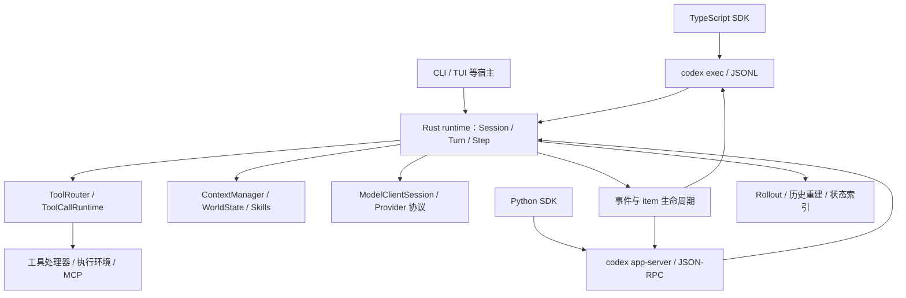

# Codex Harness 与 SDK：源码拆解及 Noval 对照

> 文档 ID：`codex-harness-sdk-source-analysis`
>
> 状态：`current`（指定源码快照的研究报告，不是 Noval 新功能上线证明）
>
> 发布边界：`repository`
>
> 研究开始：`2026-09-07`；最后审核：`2026-09-08`
>
> 负责人：`agent-runtime`

> Noval 对照部分保留研究开始时的实施前基线，包含旧的缓冲流式行为。2026-09-08 本地实现已发生增量变化，当前交付与验证见 [工具实时进度与缓存保护实施验收](2026-09-08-noval-agent-harness-implementation-acceptance.md)。本文固定 Codex 来源的研究结论不因此改写，也不构成生产上线证明。

## 1. 结论与开源边界

可以确认：`openai/codex` 公开了 Codex 的 agent harness 实现，以及 TypeScript、Python 两套 SDK 源码。这里的 harness 是模型外围负责上下文、模型调用循环、工具执行、权限、会话状态、恢复和事件输出的工程系统。模型生成下一步动作，harness 决定动作如何被执行、记录以及继续。

本次研究的源码不是只有一个聊天界面或一层 API 调用封装。Rust runtime 内已经包含完整的多轮模型／工具执行机制。两个 SDK 则负责让宿主程序控制这个 runtime，接入方式并不相同。

| 范围 | 本次确认的内容 | 不能据此推导的结论 |
| --- | --- | --- |
| CLI 与运行时 | Rust session、turn、tools、context、rollout、协议等源码 | 所有代码都在单一文件中，或适合整体搬入其他产品 |
| TypeScript SDK | `@openai/codex-sdk`，驱动 `codex exec` 的 JSONL 事件 | 与 Python SDK 使用同一套传输／事件协议 |
| Python SDK | `openai-codex`，驱动 `codex app-server` 的 stdio JSON-RPC | 直接提供 Noval 的租户、知识库、证据和业务权限体系 |
| Python runtime 包 | `openai-codex-cli-bin` 的平台二进制打包工程 | 是另一套 Python agent 核心实现 |
| App-server | 请求／通知契约、宿主接入、thread／turn／item 控制 | 整个 Codex 桌面 UI 和云端产品后端均在此仓库公开 |
| 模型 | 调用模型所需的客户端和协议适配 | 模型权重、训练流程或托管模型服务也随仓库开源 |
| 许可 | 仓库 Apache-2.0；另有 NOTICE 记录第三方来源 | 所有相关网页、模型和外部服务都受同一许可约束 |

SDK 包名及运行要求来自这次源码的 README／包元数据：TypeScript 要求 Node.js 18+；Python 要求 Python 3.10+。源码版本字段为开发版本，本次没有查询 npm/PyPI 来确认实际已发布版本。也没有把 Codex SDK 与通用 OpenAI API SDK、OpenAI Agents SDK 混为一谈。[C01、C02、C19、C27]

## 2. 版本依据与研究方法

- 用户提供的本地目录：`D:/Git/codex-main`，不存在 `.git` 元数据。
- GitHub API 本次解析得到提交：[`9f70e348e0227980de97e361cce830236fb18317`](https://github.com/openai/codex/commit/9f70e348e0227980de97e361cce830236fb18317)，提交时间 `2026-09-07T15:27:52Z`。
- 远端递归 tree 返回 8,241 个条目，`truncated=false`。对最初选定的 38 个本地源文件计算 Git blob SHA-1，与该 tree 的相应 blob **38/38 完全一致**；另保存 SHA-256 和行数供本地复查。
- 因而下文可对这些实际核验过的文件使用固定提交链接。这不表示已审计本地目录每个文件，也不把本地目录伪称为拥有该 HEAD 的 Git checkout。
- 2026-09-08 补读缓存相关实现与测试；新增引用继续对照同一份 upstream tree 校验 Git blob，并纳入本地引用清单。最初的 38 个样本数量与新增引用核验分别记录。
- 官方 SDK 网站入口本次返回 HTTP 403；产品事实以已核验的官方 GitHub 源码为依据，不引用未成功打开的网页来证明行为。
- Noval 对照基线是本地工作区 `f1e3f51deaf15eb606c1938efea7064a954ebcbe` 加已有未提交修改；它不等同于线上部署版本。

阅读顺序是：公开入口与许可证 → 两套 SDK → 模型循环 → 工具路由与执行 → 上下文与恢复 → Noval 实现与现有测试。课程方法和局限另见 [Learn Harness Engineering 拆解](2026-09-07-learn-harness-engineering-analysis.md)。

## 3. 整体分层：宿主、协议、运行时、执行环境



这里最值得借鉴的是职责边界，而不是模块数量。SDK 不拥有 agent 的推理循环；UI 不拥有业务执行真相；模型不能仅凭生成了一个工具名就获得执行权限；模型可见历史也不等于所有持久化状态。

### 3.1 Thread、Turn、Step、Item 的区别

| 层次 | 含义 | 对 Noval 的启发 |
| --- | --- | --- |
| Thread / Session | 可持续交互的会话及其运行状态 | 与持久会话对应，不能在每次追问时换成新的会话身份 |
| Turn | 一次输入发起、直到结束／中断的工作轮次 | 接近一次 Run，但不是机械的一一映射；Noval Run 有独立业务编排 |
| Step | 一次模型采样所使用的设置、工具、环境快照 | 接近一个 kernel 模型请求；同 Run 可有多个阶段和多个 Step |
| Item | 消息、工具调用／输出等有身份的过程条目 | 过程展示、增量回答、终稿需要绑定各自的 item，而不是依赖数组位置 |

工具循环的一次模型采样不是新的用户会话；一次消息的结束也不是整个任务完成。这些区分直接影响追问、流式 UI 和恢复。[C03、C04、C13、C14]

## 4. Agent 主循环如何运行

本快照的主入口是 `codex-rs/core/src/session/turn.rs::run_turn`。不要继续沿用旧文章中“所有逻辑都在 core/src/codex.rs”的路径。

1. 建立／复用 `ModelClientSession`，处理采样前压缩与输入。
2. 捕获 `StepContext`，让本次上下文、对模型公布的工具和之后执行的工具使用同一份快照。
3. 记录上下文变化，准备当前输入、必要的 Skill／插件及模型请求。
4. 流式消费模型响应：文字进入消息生命周期；工具调用完成解析后交给工具运行时。
5. 工具 future 被加入有序集合；执行结果经统一记录路径追加到会话历史。
6. 根据工具后续需求、待处理输入、上下文预算决定继续采样或压缩后继续。
7. 没有继续需求时处理 Stop hook；hook 可以反馈下一步内容。错误、取消和正常结束有不同路径。

下面是解释流程的伪代码，不是可直接调用的 SDK API：

```text
while turn 尚未终止:
    step = 捕获本次采样快照
    request = 用 step 编译上下文与工具
    stream = 请求模型
    消费消息增量与完整工具调用
    执行允许的工具，并有序记录工具结果
    结算 usage、取消和预算
    if 需要继续且上下文不足: 压缩并继续
    if 有工具结果或新输入: 继续
    if Stop hook 提供有效反馈: 继续
    结束 turn
```

`try_run_sampling_request` 在模型流中处理 output item，`ToolCallRuntime` 可提前开始适合并发的执行；`drain_in_flight` 确保返回下一阶段前收集工具结果。因此并发完成顺序与写入历史的顺序是两个不同问题。[C03、C06]

**结束条件并不自动证明领域回答正确。** Codex 可以运行测试／检查器，但“模型没有再调用工具”“Stop hook 没有拦住”本身不能证明网文事实、引用归属或榜单新鲜度。Noval 的 EvidenceCommit 与回答校验仍需要在领域层保留。

## 5. 一个很有价值的设计：每次采样的快照

`StepContext` 将下列内容组合在一起：[C04]

- 不可变的已解析设置与本次模型预算。
- 当前环境和 capability roots。
- 该步绑定的 MCP 连接、配置与目录。
- 该步已经定稿的 `ToolRouter`。
- 与环境一致的 AGENTS.md 视图。

`ToolRouter` 同时持有 model-visible specs 和执行 registry；`ToolCallRuntime` 保留最初宣告这个工具的 Step，而不是在执行时临时重新读取全局工具表。[C05、C06]

例如：模型看到工具 schema v1 后，管理员更新到 v2；旧调用不能悄悄按 v2 解释参数。这是请求快照一致性问题，而不只是多加一个版本号。现有 Step 测试覆盖设置变化、延迟激活与任务身份等边界，可作为 Noval 后续故障注入的参考；本次只读了这些测试源码，没有运行 Codex Rust 测试。[C18]

Noval 已有 Run 级 Provider snapshot、授权、Skill BOM 和 request fingerprint。适用做法是先测试这些现有快照在“声明 schema → 调用 → checkpoint → 恢复”之间是否一致，再决定是否需要显式 Step 对象。

## 6. 工具执行：声明、授权、调度和取消分开

### 6.1 工具列表与执行器共同编译

`ToolRouter` 的定稿产物既包含暴露给模型的工具规范，也关联实际运行时。工具发现、名称规范化和 executable runtime 不应由几套独立映射各自维护。[C05]

对 Noval，这对应已有 capability compiler、authorizer、registry、ledger 的一致性。用户的自然语言请求和 RAG 文本都不能直接修改授权决定。

### 6.2 并发要有明确的允许条件

`ToolCallRuntime` 查询 `tool_supports_parallel`，允许并行的工具获取读锁，需要串行的工具获取写锁。并发许可来自工具运行契约，不能从“模型一次给出多个调用”推断。[C06]

Noval kernel 当前一个回复内逐个 `await tool_executor(call)`；领域任务执行器可能另有并发。若未来优化，先量化独立只读调用的等待，再复用现有 RunToolLedger 的 join、写操作串行和幂等语义，不能直接对全部工具 `gather`。

### 6.3 执行边界集中治理

`ToolOrchestrator` 为需要该执行边界的 `ToolRuntime` 集中处理审批、环境／沙箱选择、执行尝试和受策略约束的重试。它不是一段“模型说可以就执行”的提示词。[C07]

Noval 是面向租户和项目的问答服务，适合迁移的是统一的执行前校验；不需要为查询书籍照搬编码 agent 的 shell 权限界面。

### 6.4 取消也要收口

工具运行时保留取消 token，取消会处理运行中的 future 和终态通知；采样结束前还会收集工具结果、记录已产生的 usage。[C03、C06]

这不意味着外部写操作自动具备 exactly-once。Noval 现有 `TOOL_PREPARED / TOOL_COMMITTED / TOOL_UNKNOWN` 和幂等键必须继续约束未知结果的恢复，不能把网络中断当作“肯定没执行”。

## 7. 上下文：模型窗口与持久事实分离

`ContextManager` 维护模型窗口 items、host-owned retained context、历史版本、用户输入修订号、上下文差异基线等。`history_version` 与 `user_message_revision` 分开，说明“模型窗口重写”和“用户意图改变”不是同一个事件。[C08]

### 7.1 平时追加，显式边界才重写

常规交互尽量复用既有前缀，只追加输入、输出与必要的环境／设置变化。压缩、回滚等是显式的历史替换边界。不要把“稳定前缀”误解为永远不能压缩，也不要把压缩包装成毫无语义影响的字符串缩短。

`ModelClientSession` 还保留上次请求以判断 WebSocket 的增量请求能否复用。这是传输／请求连续性优化，不是任意 Provider 都支持的通用缓存协议，更不保证 KV cache 命中。[C17]

### 7.2 压缩之后还要重建正确上下文

源码区分轮次前／手动压缩和轮次中压缩，控制初始上下文的重新注入位置；压缩记录与 replacement history 的 item 身份一起维护，使 live history 与 replay history 一致。[C10]

这部分包含 Codex 模型训练与协议假设。对 Noval 应迁移“不丢受信目标、作用域和未完成事项”的不变式；不要无条件复制摘要消息的位置、角色或远端压缩 API。

### 7.3 工具调用与输出必须成对

history normalization 会识别缺失的调用输出等异常形状。[C09] Noval 已有调用／输出配对和压缩收敛测试。进一步的重点是跨压缩、取消、恢复后，当前目标、证据版本和未完成任务仍保持一致，而不是再增加一个普通摘要字段。

### 7.4 Skill 采用目录与按需读取

Skill catalog 保存可发现的名称、说明和来源定位信息，模型按需求读取正文。目录预算、正文加载、扩展资源访问分属不同责任。[C15、C16]

Noval 已有阶段 Skill 与正文预算，适合继续度量各阶段真正进入上下文的 token 和质量收益。不能把 Skill 正文提升为系统授权，也不能让加载 Skill 绕过数据访问工具的权限。

## 8. 状态持久化与恢复

Codex 的 `RolloutRecorder` 把 canonical session items 写入 JSONL，由 writer task 处理队列，并提供有确认的 `persist()`／`flush()` 等生命周期方法。状态数据库也参与 thread 列表等索引读取。[C11]

恢复逻辑不是简单地把日志全部拼接：`reconstruct_history_from_rollout` 选择仍然有效的 replacement-history checkpoint，结合其所属分段和后续条目重建历史，避免把已回滚内容重新带回。[C12]

因此，课程将状态主要概括为“文件和约定”只能解释开发工作流的一部分；实际 runtime 自己具有历史、压缩检查点和恢复实现。

对 Noval：MySQL Run/Event、Worker checkpoint、工具账本和恢复 fence 才是现有业务基础。JSONL 是 Codex 本地运行场景的具体存储选择，不构成替换 Noval 数据库、消息队列或租户隔离的理由。

## 9. 两套 SDK 必须分开学习

| 比较项 | TypeScript SDK | Python SDK |
| --- | --- | --- |
| 包名 | `@openai/codex-sdk` | `openai-codex` |
| 核心启动方式 | `codex exec --experimental-json` | `codex app-server --listen stdio://` |
| 传输 | 子进程 stdin 输入、stdout JSONL 事件 | 长驻 app-server 上的 stdio JSON-RPC |
| 会话入口 | `startThread()` / `resumeThread()` | `thread_start()` / thread resume 等操作 |
| 简便结果接口 | `Thread.run()` | thread 的 `run()` 与 `TurnResult` |
| 过程接口 | `runStreamed()` 返回异步事件生成器 | turn stream 与类型化 app-server notification |
| 典型事件 | `thread.started`、`item.completed`、`turn.completed` | `item/started`、`item/agentMessage/delta` 等 app-server 方法 |
| 取消／控制 | `AbortSignal`、子进程清理 | turn 的 steer／interrupt 等控制及客户端关闭 |
| 异步实现要点 | Node 子进程、readline、AsyncGenerator | 本快照 async facade 经 `asyncio.to_thread` 调用同步客户端 |

### 9.1 TypeScript：在事件流上收集结果

`Thread.run()` 消费同一条 `runStreamedInternal()` 事件流，汇集完成的 items、最终回答和 usage；不是另写一条执行路径。恢复时将已存 thread ID 传给 exec 的 resume 参数。输出 schema 经临时文件传入 CLI，并在 finally 中清理。[C19、C20、C21、C22]

`runStreamed()` 的“流”是 exec 的结构化生命周期事件，不能假定它等同于 app-server 的逐字符 delta 协议。SDK 的 TypeScript 类型也不能自动替代运行时输入验证。

### 9.2 Python：单读取者与按轮次分发

同步 `CodexClient` 启动一个 app-server 子进程，单独的 reader 消费 stdout。`MessageRouter` 按 JSON-RPC request ID 和 turn ID 给等待中的操作分配队列，并缓冲早于 TurnHandle 到达的通知。[C23、C24]

这解决了一个真实并发问题：两个操作不能各自读取同一 stdout，然后把另一个操作的事件拿走。可借鉴的是**唯一入口 + 身份分发 + 早到事件处理**；服务端还需根据自身负载设计队列上限和慢消费者策略。

`_collect_turn_result` 按 turn ID 过滤 item 和 usage，缺少 completion event 就报错；提取最终答案时优先选择 `final_answer`，避免把 commentary 当成终稿。[C25]

对 Noval 的启发是：阻塞结果、SSE、重放和最终消息应消费同一份受控事件语义。客户端断连、主动取消业务 Run、模型失败、校验失败和回答完成应分别表示。

### 9.3 是否把 Codex SDK 接入问答主链路

当前不建议因此替换 Noval 的 Worker。两套 SDK 主要帮助应用控制 Codex agent，都仍依赖 Codex runtime、相应模型接入与执行环境；它们并不接管 Noval 的作品身份、引用、章节版本、知识库权限和持久化 Run。

如果未来新增“生成分析脚本／操作受控文件工作区”的编码能力，可以把 SDK 作为独立工具后端再评估。仅为了改善现有问答的循环、流式和恢复，直接移植设计更符合现有架构。

## 10. Noval 对照后的采用次序

| 设计 | 当前判断 | 下一步 |
| --- | --- | --- |
| 缓存稳定性回归 | Noval 已有稳定前缀、逻辑身份、工具规范化及连续性诊断 | 作为其他改造的前置门槛；区分请求复用条件与实际命中 |
| 同一事件流支撑 run 与 stream | kernel 有工具时仍存在缓冲后投影的路径 | 缓存契约明确后做工具轮次实时事件流，保留原账本和终态规则 |
| thread／turn／item 身份 | 已有 conversation、run、sequence 和恢复防串线 | 增强过程 item 身份、payload 类型及版本；避免再建一套 Run |
| 采样 Step 快照 | 已有 run snapshot、Profile 和权限指纹 | 先做声明／执行／恢复一致性测试，再补必要字段 |
| 压缩保留受信任务状态 | 已有任务检查点、成对工具历史和两层压缩 | 做长对话质量与恢复测试，不重复实现普通摘要 |
| 验证与有界修复 | 已有首版确定性验证、一次证据修复和返工复核 | 固定模型／预算做效果实验，保留 `unknown` |
| Skill 渐进加载 | 已有阶段筛选和 BOM | 度量正文预算与阶段收益，不默认增加专家／Skill 数量 |

Noval 当前工具流式分支的直接证据：[AgentKernel.stream](../../../langgraph-worker/app/services/harness/agent_kernel.py#L1046) 在有工具的情况下进入 [先 run 再遍历事件](../../../langgraph-worker/app/services/harness/agent_kernel.py#L1288)。其余已实现能力以 [当前架构](../findings/2026-08-16-deepseek-harness-review/01-noval-ai-qa-current-architecture.md)、本地源码与测试共同判断，不能仅按旧计划中的勾选框推断。

进一步核对 [主问答图流式入口](../../../langgraph-worker/app/services/novel_research_agent.py#L889)：当前使用节点完成后的 `updates`，终稿组装后再发送积累或合成的正文 delta。因此工具过程实时化需要贯通节点内部、Worker SSE、Backend 和前端；单改 kernel 不能证明端到端实时。

## 11. 本次验证及限制

在 Noval Worker 目录运行：

```powershell
python -m pytest tests/test_agent_kernel.py tests/test_context_compaction.py tests/test_agent_checkpoint_resume.py tests/test_harness_intelligence.py -q
```

结果：**90 passed，9.32 秒**；一条既有 `python_multipart` 依赖弃用提示。验证的是选定的离线机制；没有运行 Codex 全量编译／测试、课程应用、真实模型质量实验或线上验收。本次只修改研究文档和本地研究记录，没有修改产品逻辑。

2026-09-08 缓存补充研究另执行以下现有测试，结果为 **34 passed，130 deselected，2.55 秒**。与上面的 90 项存在重叠，不能相加为独立覆盖数。

```powershell
python -m pytest tests/test_agent_kernel.py tests/test_provider_client.py tests/test_provider_dispatch_scope.py tests/test_context_assembler.py tests/test_context_compaction.py -q -k "cache or affinity or prefix or continuity or usage or surface"
```

## 12. 缓存补充：Codex 做了什么，Noval 应保留什么

### 12.1 四种机制分别看待

开源客户端通过稳定请求内容、缓存路由身份和续接协议创造复用条件；模型服务端的 KV 缓存实现、淘汰算法和实际命中保证不在这些客户端源码中。工具结果复用和本地对象缓存也不能计作模型前缀命中。

| 机制 | 源码确认的行为 | 边界 |
| --- | --- | --- |
| 缓存身份 | `ModelClient::prompt_cache_key` 优先显式 override，再处理内部来源／父 thread，默认返回 `session_id`；普通 Responses 请求带此字段 [C28] | `session_id` 不等于每个 thread／turn 的 ID；相同 key 本身不证明命中 |
| 稳定输入前缀 | 测试比较前后请求的 instructions、tools 及历史 input；测试中的权限、环境和模型上下文变更追加到旧前缀之后 [C29] | 不代表所有变更都保持整段缓存；执行权限仍须按当前受信规则校验 |
| 传输续接 | WebSocket 路径比较模型、instructions、tools、推理等属性，再确认旧 input 加服务端 output 是当前 input 的前缀；满足条件才使用 `previous_response_id` 与增量 input [C28] | 缩短传输不等同于增加缓存命中；条件不成立就不能沿用旧 continuation |
| 实际用量 | 从 `response.completed` 的 `input_tokens_details.cached_tokens`、`cache_write_tokens` 构造 usage [C31] | 用量来自服务端；源码测试的 mock 数字不是实际命中率 |

`ModelClientSession` 还保留 WebSocket 连接和同轮 sticky routing 的 `x-codex-turn-state`。[C17] 这是连接／路由连续性；Noval 应先保住已有 Profile／路由冻结，再对目标 Provider 评估相应协议，不能把该头作为通用缓存开关。

### 12.2 缓存 key 不应简单改成每 Run 一个

API-key 子 agent 的现有测试验证：父子 thread 的 `thread-id` 不同，但它们可以共享 `session-id` 和 `prompt_cache_key`。[C30] Guardian reviewer 另按 `guardian:{parent_thread_id}` 生成 override，展示了按工作类型与父任务限定复用范围的做法。[C33] 这些都不能直接推导为 Noval 应跨用户共享上下文。

Noval 的 [逻辑缓存身份](../../../langgraph-worker/app/services/harness/agent_kernel.py#L25) 优先采用“用户＋项目”，其次用户，再回退到 conversation／trace；[现有测试](../../../langgraph-worker/tests/test_agent_kernel.py#L948) 已要求同一用户／项目跨会话保持身份稳定。直接改为每个 Run、每轮、每个过程 item 的 ID 会改变现有身份，应从首批改造中排除。

### 12.3 压缩复用身份，也会改变输入

Codex 远端 compaction 从普通请求提取相同的 `prompt_cache_key`，相关测试检查请求字段对齐。[C28、C32] 这说明压缩请求没有无故另造缓存身份；不说明压缩后仍能复用被重写历史的全部缓存。

Noval 已有两层 compaction、输入指纹和压缩 generation。应保留正确的目标、权限、证据版本和工具配对，再比较压缩前后总输入、缓存读取／写入和任务成本；不能为维持命中率保留过期证据或持续增加历史长度。

在本次查看的 Codex `ResponsesApiRequest` 构造路径中，没有发现与 Noval 本地 `openai_gpt_5_6` 策略相同的显式 TTL／breakpoint 编译逻辑。这个客户端差异不是删除 Noval Provider 专属字段的依据，也不是所有 OpenAI-compatible 端点支持同一缓存参数的证明。

### 12.4 对 Noval 的增量价值

| Noval 当前事实 | 应保留的设计 | 可验证的下一步 |
| --- | --- | --- |
| [ContextAssembler](../../../langgraph-worker/app/services/runtime/context_assembler.py#L63) 已按稳定性排列 policy／Skill／expert／动态上下文 | 保留实际文本、角色、顺序和受信边界 | 将稳定性测试延伸到实际 Provider 请求，覆盖多轮工具、阶段变化和 run／stream |
| [工具声明已有规范化测试](../../../langgraph-worker/tests/test_agent_kernel.py#L1485) | 保留授权后工具集合、顺序和 schema 序列化 | 检查事件 item 字段或新适配器是否意外进入模型请求；无需再次全局排序改造 |
| [ProviderClient](../../../langgraph-worker/app/services/provider_client.py#L1184) 已按实际 Profile 编译缓存策略 | 保留已有 key 编码、Provider user、TTL、breakpoint 与未知路由的保守行为 | 按实际 Provider／协议分别验证；不要把 Codex 专属续接头复制给其他端点 |
| [连续性快照](../../../langgraph-worker/app/services/provider_client.py#L1352) 已有多维指纹和输入链 | 保留脱敏诊断，与服务端用量分开 | 先检查字段覆盖与首个变化位置，再选择确有收益的前缀优化 |
| [用量归一化](../../../langgraph-worker/app/services/provider_client.py#L1583) 区分上报、缺失、显式零和推导 miss | 保留来源标志和调用归属，replay 不重复累计 | 在新的事件流／reducer 上验证 token、缓存读写和模型调用数一致 |

最适合优先借鉴的是“请求前缀不变式＋完整用量反馈＋明确失效原因”。WebSocket 预热、服务端 continuation、缓存身份迁移和新的 TTL 策略属于条件性优化，应先证明对应 Provider 支持及收益。

## 13. 固定提交源码索引

以下链接均固定到本次核验的 Codex 提交。C 编号用于对应正文论断；文件移动后仍可通过固定提交查看。

| 编号 | 源码及入口 | 用途 |
| --- | --- | --- |
| C01 | [README](https://github.com/openai/codex/blob/9f70e348e0227980de97e361cce830236fb18317/README.md#L1) | CLI、桌面／云入口与仓库范围 |
| C02 | [LICENSE](https://github.com/openai/codex/blob/9f70e348e0227980de97e361cce830236fb18317/LICENSE#L1)、[NOTICE](https://github.com/openai/codex/blob/9f70e348e0227980de97e361cce830236fb18317/NOTICE#L1) | 许可及第三方声明 |
| C03 | [session/turn.rs](https://github.com/openai/codex/blob/9f70e348e0227980de97e361cce830236fb18317/codex-rs/core/src/session/turn.rs#L163) | 主循环；同文件 2226、2274、2854 行为流与工具收集 |
| C04 | [session/step_context.rs](https://github.com/openai/codex/blob/9f70e348e0227980de97e361cce830236fb18317/codex-rs/core/src/session/step_context.rs#L15) | 采样请求快照 |
| C05 | [tools/router.rs](https://github.com/openai/codex/blob/9f70e348e0227980de97e361cce830236fb18317/codex-rs/core/src/tools/router.rs#L73) | 工具声明与运行时一致性 |
| C06 | [tools/parallel.rs](https://github.com/openai/codex/blob/9f70e348e0227980de97e361cce830236fb18317/codex-rs/core/src/tools/parallel.rs#L95) | 并发门、取消与终态 |
| C07 | [tools/orchestrator.rs](https://github.com/openai/codex/blob/9f70e348e0227980de97e361cce830236fb18317/codex-rs/core/src/tools/orchestrator.rs#L121) | 执行审批、环境与沙箱策略 |
| C08 | [context_manager/history.rs](https://github.com/openai/codex/blob/9f70e348e0227980de97e361cce830236fb18317/codex-rs/core/src/context_manager/history.rs#L69) | 模型窗口、保留事实与版本 |
| C09 | [context_manager/normalize.rs](https://github.com/openai/codex/blob/9f70e348e0227980de97e361cce830236fb18317/codex-rs/core/src/context_manager/normalize.rs#L21) | 调用与输出的历史规范化 |
| C10 | [compact.rs](https://github.com/openai/codex/blob/9f70e348e0227980de97e361cce830236fb18317/codex-rs/core/src/compact.rs#L65) | 压缩与初始上下文重新注入 |
| C11 | [rollout/recorder.rs](https://github.com/openai/codex/blob/9f70e348e0227980de97e361cce830236fb18317/codex-rs/rollout/src/recorder.rs#L77) | JSONL、writer 队列、persist／flush |
| C12 | [session/rollout_reconstruction.rs](https://github.com/openai/codex/blob/9f70e348e0227980de97e361cce830236fb18317/codex-rs/core/src/session/rollout_reconstruction.rs#L134) | checkpoint 与有效历史段重建 |
| C13 | [app-server protocol/common.rs](https://github.com/openai/codex/blob/9f70e348e0227980de97e361cce830236fb18317/codex-rs/app-server-protocol/src/protocol/common.rs#L1010) | turn/start、steer、interrupt |
| C14 | [app-server protocol/v2/item.rs](https://github.com/openai/codex/blob/9f70e348e0227980de97e361cce830236fb18317/codex-rs/app-server-protocol/src/protocol/v2/item.rs#L1321) | item 生命周期与 delta 身份 |
| C15 | [ext/skills/catalog.rs](https://github.com/openai/codex/blob/9f70e348e0227980de97e361cce830236fb18317/codex-rs/ext/skills/src/catalog.rs#L171) | Skill 元数据与来源 |
| C16 | [ext/skills/catalog_prompt.rs](https://github.com/openai/codex/blob/9f70e348e0227980de97e361cce830236fb18317/codex-rs/ext/skills/src/catalog_prompt.rs#L81) | 目录呈现与按需读取 |
| C17 | [core/client.rs](https://github.com/openai/codex/blob/9f70e348e0227980de97e361cce830236fb18317/codex-rs/core/src/client.rs#L271) | 模型连接与增量请求连续性 |
| C18 | [step_activation_tests.rs](https://github.com/openai/codex/blob/9f70e348e0227980de97e361cce830236fb18317/codex-rs/core/src/session/step_activation_tests.rs#L272) | 快照与延迟激活测试参考 |
| C19 | [TypeScript README](https://github.com/openai/codex/blob/9f70e348e0227980de97e361cce830236fb18317/sdk/typescript/README.md#L1)、[thread.ts](https://github.com/openai/codex/blob/9f70e348e0227980de97e361cce830236fb18317/sdk/typescript/src/thread.ts#L1) | SDK 接入和结果收集 |
| C20 | [TypeScript exec.ts](https://github.com/openai/codex/blob/9f70e348e0227980de97e361cce830236fb18317/sdk/typescript/src/exec.ts#L91) | 子进程、resume 与清理 |
| C21 | [TypeScript events.ts](https://github.com/openai/codex/blob/9f70e348e0227980de97e361cce830236fb18317/sdk/typescript/src/events.ts#L1) | exec SDK 事件契约 |
| C22 | [outputSchemaFile.ts](https://github.com/openai/codex/blob/9f70e348e0227980de97e361cce830236fb18317/sdk/typescript/src/outputSchemaFile.ts#L1) | 输出 schema 的资源生命周期 |
| C23 | [Python client.py](https://github.com/openai/codex/blob/9f70e348e0227980de97e361cce830236fb18317/sdk/python/src/openai_codex/client.py#L212) | app-server 启动与同步客户端 |
| C24 | [Python _message_router.py](https://github.com/openai/codex/blob/9f70e348e0227980de97e361cce830236fb18317/sdk/python/src/openai_codex/_message_router.py#L17) | 消息分发与早到事件 |
| C25 | [Python _run.py](https://github.com/openai/codex/blob/9f70e348e0227980de97e361cce830236fb18317/sdk/python/src/openai_codex/_run.py#L68) | 终态验证与结果聚合 |
| C26 | [Python async_client.py](https://github.com/openai/codex/blob/9f70e348e0227980de97e361cce830236fb18317/sdk/python/src/openai_codex/async_client.py#L52) | 异步 facade 的实际实现 |
| C27 | [Python README](https://github.com/openai/codex/blob/9f70e348e0227980de97e361cce830236fb18317/sdk/python/README.md#L1)、[pyproject.toml](https://github.com/openai/codex/blob/9f70e348e0227980de97e361cce830236fb18317/sdk/python/pyproject.toml#L1)、[runtime README](https://github.com/openai/codex/blob/9f70e348e0227980de97e361cce830236fb18317/sdk/python-runtime/README.md#L1) | Python 包、运行条件和二进制依赖 |
| C28 | [client.rs 缓存身份](https://github.com/openai/codex/blob/9f70e348e0227980de97e361cce830236fb18317/codex-rs/core/src/client.rs#L504)、[增量输入判断](https://github.com/openai/codex/blob/9f70e348e0227980de97e361cce830236fb18317/codex-rs/core/src/client.rs#L1331) | 普通请求与 compaction 复用身份；属性／历史兼容后才续接 |
| C29 | [prompt_caching.rs](https://github.com/openai/codex/blob/9f70e348e0227980de97e361cce830236fb18317/codex-rs/core/tests/suite/prompt_caching.rs#L355) | 稳定前缀、工具声明及变更追加的请求测试 |
| C30 | [prompt_cache_key.rs](https://github.com/openai/codex/blob/9f70e348e0227980de97e361cce830236fb18317/codex-rs/core/tests/suite/prompt_cache_key.rs#L126) | API-key 父子 thread 的 session／cache key 对照 |
| C31 | [sse/responses.rs](https://github.com/openai/codex/blob/9f70e348e0227980de97e361cce830236fb18317/codex-rs/codex-api/src/sse/responses.rs#L138) | 服务端缓存读取／写入 token 到 usage 的映射 |
| C32 | [compact_remote.rs](https://github.com/openai/codex/blob/9f70e348e0227980de97e361cce830236fb18317/codex-rs/core/tests/suite/compact_remote.rs#L1370) | 远端 compaction 复用 prompt_cache_key 的测试 |
| C33 | [guardian/review_session.rs](https://github.com/openai/codex/blob/9f70e348e0227980de97e361cce830236fb18317/codex-rs/core/src/guardian/review_session.rs#L289) | 特定 reviewer 的缓存身份 override |
